<div align="center">

<picture>
  <source media="(prefers-color-scheme: dark)" srcset="assets/brand/kaza-odak-logo-on-dark.svg">
  
</picture>

### Makine Öğrenmesi ile Trafik Kazalarının Mekânsal Analizi ve 3D Görselleştirilmesi

New York'ta polise bildirilmiş **2,27 milyon** trafik kazası kaydında tekrar eden mekânsal yoğunlaşmaları
denetimsiz öğrenmeyle (DBSCAN) keşfeden ve sonuçları gerçek coğrafyaya hizalı, etkileşimli bir **3D şehirde** sunan
akademik makine öğrenmesi projesi.


</div>

<p align="center">
  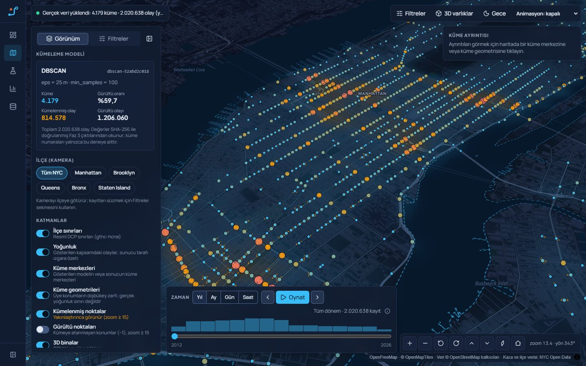
</p>

> [!IMPORTANT]
> Kaza Odak trafik kazası **tahmini yapmaz**. Geçmişte kaydedilmiş kazaların mekânsal yoğunlaşmalarını bulur.
> Trafik hacmi verisi olmadığı için yüksek kaza yoğunluğu, araç veya yaya başına **risk** anlamına gelmez.

## İçindekiler

- [Öne çıkanlar](#öne-çıkanlar)
- [Ekranlar](#ekranlar)
- [Temel sonuçlar](#temel-sonuçlar)
- [Yöntem](#yöntem)
- [Mimari](#mimari)
- [Hızlı başlangıç](#hızlı-başlangıç)
- [Testler ve kalite](#testler-ve-kalite)
- [Depo yapısı](#depo-yapısı)
- [Akademik teslim dosyaları](#akademik-teslim-dosyaları)
- [Veri kaynakları, atıf ve lisanslar](#veri-kaynakları-atıf-ve-lisanslar)
- [Sınırlılıklar](#sınırlılıklar)

## Öne çıkanlar

- **Gerçek, büyük veri:** NYC Open Data *Motor Vehicle Collisions – Crashes* (2012-07-01 → 2026-06-11), 2.269.187 kayıt;
  değişmez anlık görüntü, SHA-256 ile doğrulanan edinim ve işleme manifestleri.
- **Şeffaf veri hazırlığı:** hiçbir kayıt sessizce silinmez; geçersiz koordinatlar gerekçeleriyle işaretlenir, eksik
  ilçeler resmî DCP sınırlarından nokta-çokgen eşleşmesiyle kurtarılır (478.280 kayıt).
- **Kavşak ölçeğinde kümeleme:** ağırlıklı, haversine metrikli DBSCAN (eps = 25 m, min_samples = 100) tam veride
  4.179 kronik yoğunlaşma buldu; K-Means ve HDBSCAN ile aynı soru farklı varsayımlarla karşılaştırıldı.
- **Önceden tanımlı seçim kuralları:** 20 tam veri DBSCAN deneyi, seçim ölçütleri sonuçlardan önce sabitlenerek
  değerlendirildi; zamansal kararlılık ve veri kalitesi duyarlılığı ayrıca sınandı.
- **Gerçek coğrafyada 3D:** MapLibre + OpenStreetMap bina yükseklikleri; Three.js ile lisanslı (CC0) GLB modeller;
  yükseklik verisi olmayan binalar uydurma yükseklikle çizilmez.
- **Analiz uygulaması:** filtreler, zaman oynatma, küme ayrıntısı, model karşılaştırma, veri gezgini ve sunucuda
  gerçek kümeleme çalıştıran **Kümeleme Laboratuvarı** (iş kuyruğu, iptal, bellek koruması, kalıcı deney kaydı).
- **Doğrulanabilirlik:** her ekrandaki sayı API'den gelir; arayüz, API ve Faz 3 kayıtlarının eşliği testlerle denetlenir.

## Ekranlar

<table>
  <tr>
    <td width="50%">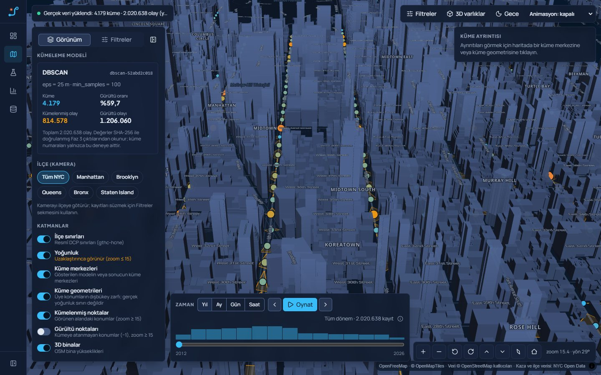<br><sub><b>3D Şehir Keşfi</b> — Midtown Manhattan, OSM bina yükseklikleri, gece modu</sub></td>
    <td width="50%">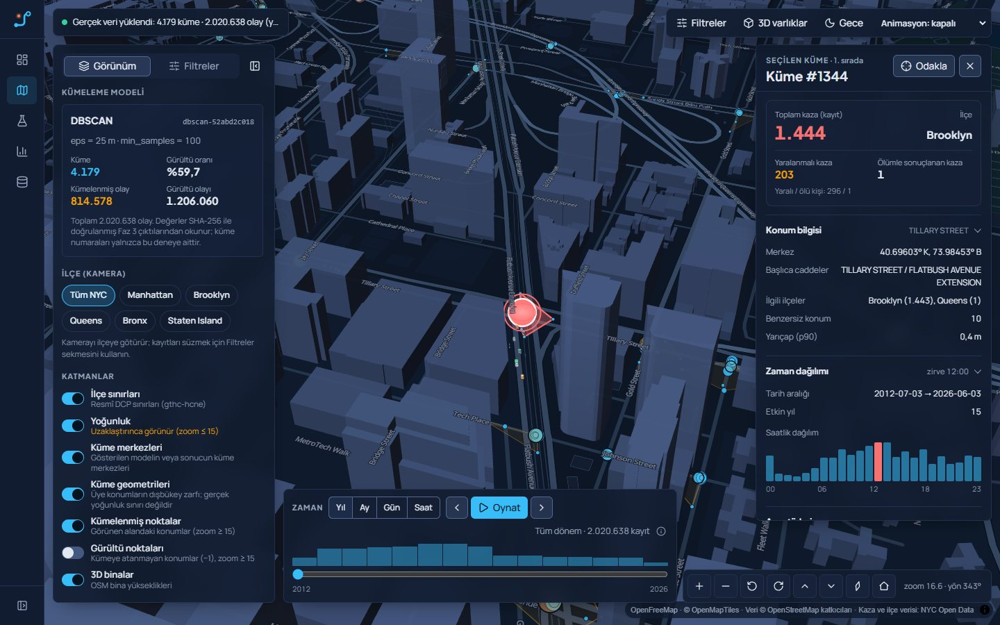<br><sub><b>Küme ayrıntısı</b> — #1344 Tillary St / Flatbush Ave Ext: 1.444 kaza, saatlik dağılım, araç türleri</sub></td>
  </tr>
  <tr>
    <td>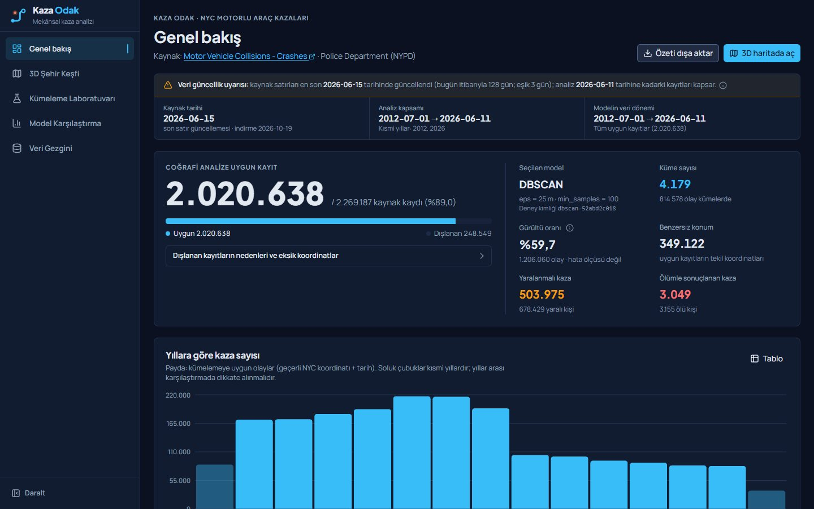<br><sub><b>Genel bakış</b> — veri kapsamı, güncellik uyarısı, model özeti, yıllık dağılım</sub></td>
    <td>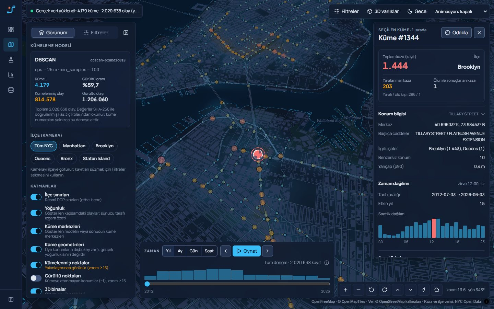<br><sub><b>Seçim vurgusu</b> — seçili küme halkası, diğer kümeler geri planda; boyut ve renk kayıt sayısı</sub></td>
  </tr>
  <tr>
    <td>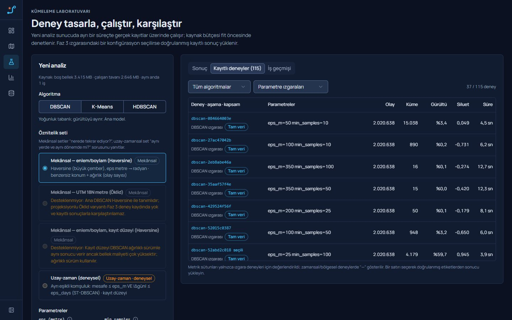<br><sub><b>Kümeleme Laboratuvarı</b> — DBSCAN / K-Means / HDBSCAN, öznitelik seti, kayıtlı 115 deney</sub></td>
    <td>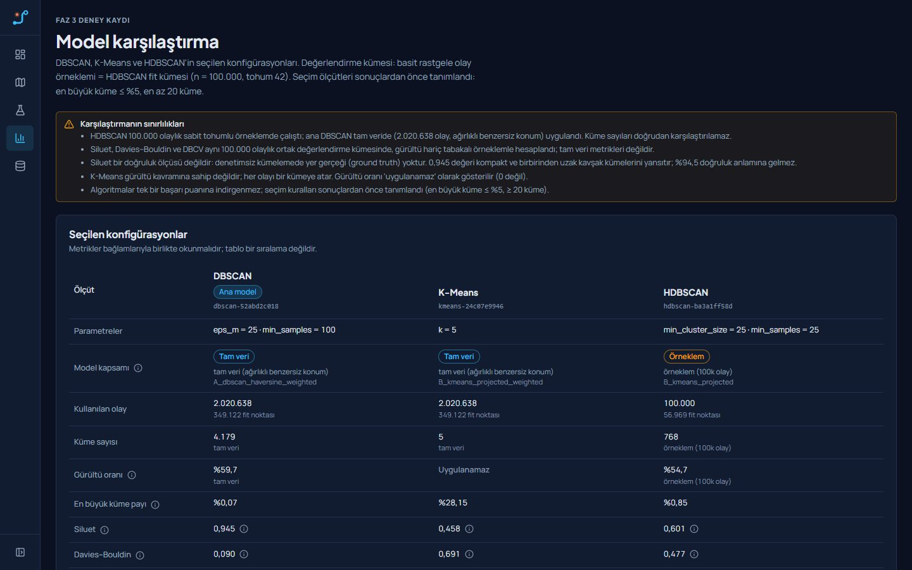<br><sub><b>Model karşılaştırma</b> — aynı metrikler, farklı varsayımlar; kapsam farkları açıkça işaretli</sub></td>
  </tr>
  <tr>
    <td>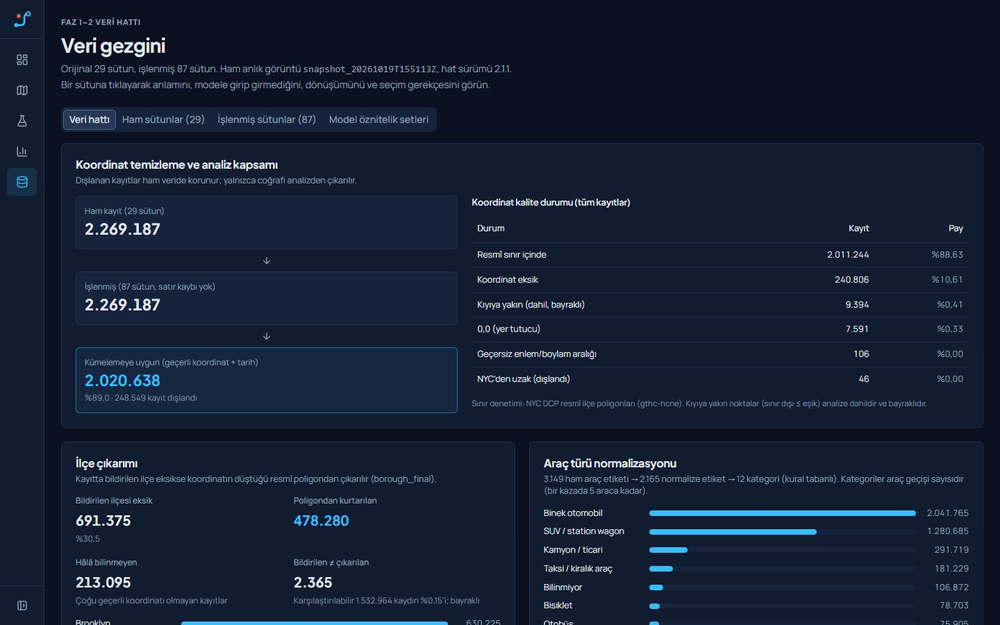<br><sub><b>Veri gezgini</b> — veri hattı, 29 ham / 87 işlenmiş sütun, modele giriş gerekçeleri</sub></td>
    <td>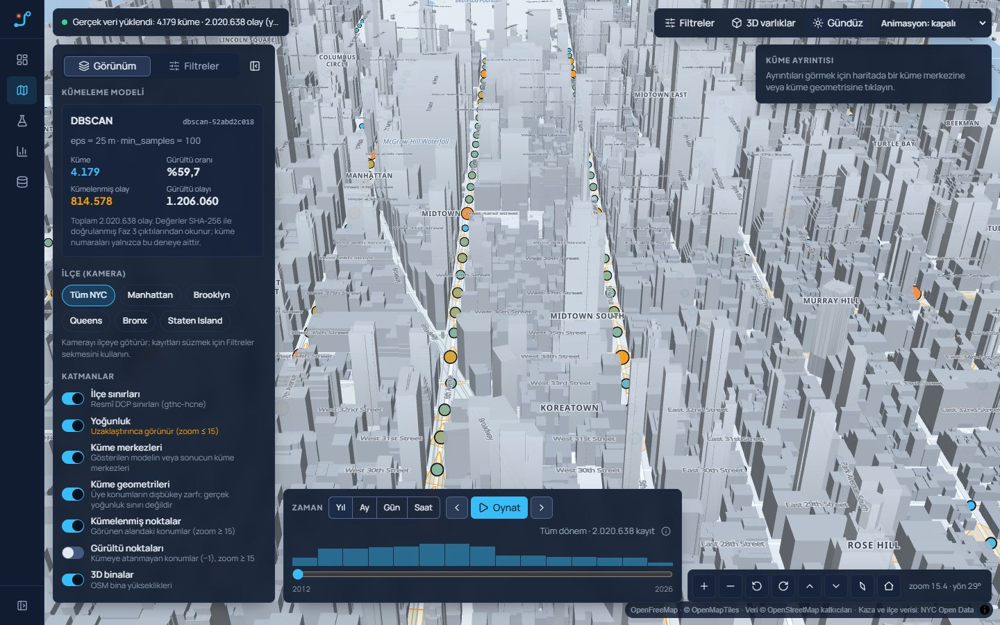<br><sub><b>Gündüz modu</b> — aynı sahne; bina tonu yüksekliğe göre kontrollü açılır</sub></td>
  </tr>
</table>

<table>
  <tr>
    <td width="26%" valign="top">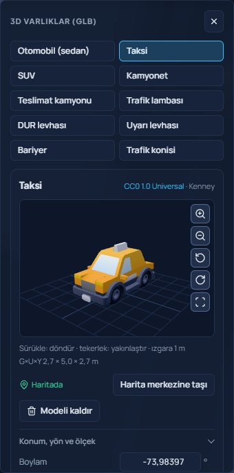<br><sub><b>3D varlıklar</b> — GLB önizleyici (döndür, yakınlaştır, sıfırla), lisans bilgisi, haritaya yerleştirme</sub></td>
    <td width="74%" valign="top">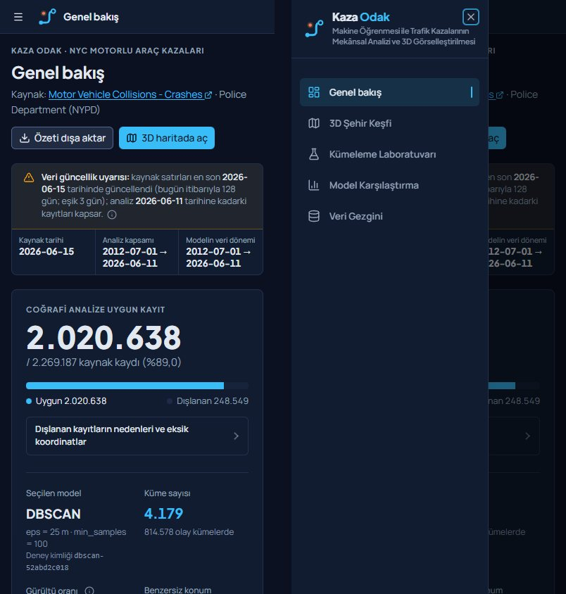<br><sub><b>Mobil</b> — 390 px Genel bakış ve gezinme menüsü; 768–2560 px arası düzenler test edilir</sub></td>
  </tr>
</table>

## Temel sonuçlar

| | |
|---|---|
| Kaynak kayıt | **2.269.187** (NYPD, 2012-07-01 → 2026-06-11) |
| Coğrafi analize uygun | **2.020.638** (%89,0) · 349.122 benzersiz konum |
| Seçilen model | **DBSCAN** · haversine · eps = 25 m · min_samples = 100 · konum ağırlıklı · tam veri |
| Küme | **4.179** · kümelenmiş olay 814.578 · gürültü %59,69 |
| İç geçerlilik (DBSCAN) | siluet 0,945 · Davies–Bouldin 0,090 · DBCV 0,394 |
| En yoğun küme | #1344 Tillary St / Flatbush Ave Extension (Brooklyn) — 1.444 kaza |

| Model | Kapsam | Küme | Siluet | Not |
|---|---|---:|---:|---|
| **DBSCAN** (ana) | tam veri | 4.179 | 0,945 | yoğunluk tabanlı; gürültüyü (−1) ayırır |
| K-Means | tam veri | 5 | 0,458 | bölümleyici; her olayı bir kümeye zorlar, gürültü kavramı yok |
| HDBSCAN | 100.000 olay örneklemi | 768 | 0,601 | değişken yoğunluk; bellek nedeniyle örneklemde |

> Etiketli "doğru sıcak nokta" verisi olmadığı için *accuracy* hesaplanmaz; siluet gibi iç geçerlilik ölçütleri
> doğruluk değil, geometrik ayrışma göstergesidir. Yüksek gürültü oranı bir hata ölçüsü değildir: model yalnızca kavşak
> ölçeğindeki kronik yoğunlaşmaları temsil eder.

<p align="center">
  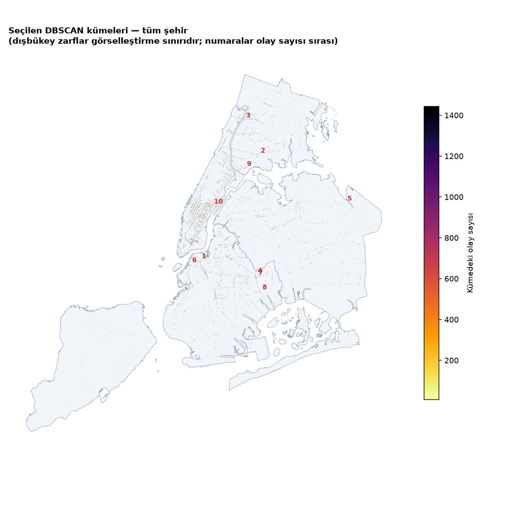
  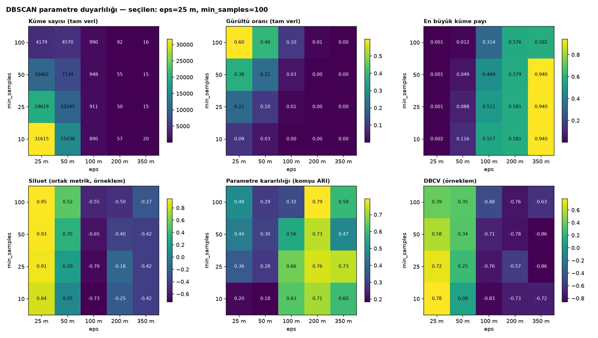
</p>

## Yöntem

1. **Edinim (Faz 1):** Socrata SODA API ile sayfalı, yeniden denemeli tam indirme; değişmez anlık görüntü, SHA-256
   bütünlük kaydı, otomatik EDA ve veri sözlüğü.
2. **Ön işleme ve öznitelikler (Faz 2):** koordinat kalite sınıfları, resmî ilçe sınırlarıyla nokta-çokgen eşleşmesi,
   zaman/araç/yaralanma alanlarının normalizasyonu, tekrar kayıt denetimi; model öznitelik setleri
   (radyan, UTM metre, döngüsel zaman) ve gerekçeli öznitelik seçimi.
3. **Kümeleme (Faz 3):** benzersiz konum + kayıt sayısı ağırlığıyla DBSCAN (kayıt düzeyiyle eşdeğerliği gerçek veride
   doğrulandı), ağırlıklı k-mesafe analizi, 20 tam veri deneyi, önceden tanımlı seçim kuralları; K-Means ve HDBSCAN
   karşılaştırması; zamansal kararlılık (Jaccard) ve veri kalitesi duyarlılığı. Her deney kimlikli olarak kaydedilir.
4. **3D şehir (Faz 4):** manifesti SHA-256 ile doğrulanan coğrafi katmanlar, FastAPI katman API'si, MapLibre + Three.js.
5. **Analiz uygulaması ve güvenilirlik (Faz 5–6):** beş ekran, filtreli kayıt sorguları (küme etiketleri yeniden
   hesaplanmaz), dinamik kümeleme iş kuyruğu, kaynak sınırları, kalıcı iş kaydı, WebGL bağlam kaybından toparlanma.
6. **Cila ve denetim (Faz 7–8B):** akademik teslim paketi, 125 etkileşimli işlevsel denetim, görsel iyileştirme, erişilebilirlik.

Ayrıntılar: [`PROJECT_SPEC.md`](PROJECT_SPEC.md), faz raporları [`docs/phase1`](docs/phase1/TEKNIK_RAPOR.md) …
[`docs/phase8b`](docs/phase8b/TEKNIK_RAPOR.md), karar günlüğü [`docs/decision_log.md`](docs/decision_log.md).

## Mimari

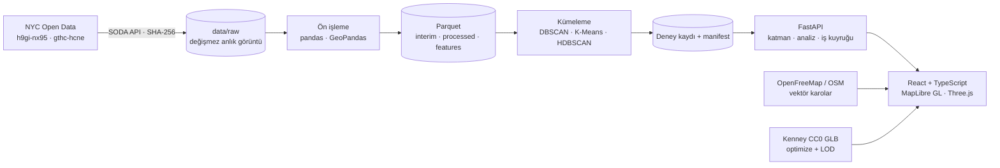

| Katman | Teknolojiler |
|---|---|
| Veri ve model | Python 3.12, pandas, NumPy, GeoPandas/Shapely, PyArrow, scikit-learn 1.9, hdbscan |
| API | FastAPI, Uvicorn, SQLite (kalıcı iş kaydı), JSON deney kaydı, alt süreçte izole kümeleme işleri |
| Ön yüz | React 19, TypeScript, Vite, Tailwind CSS 4, Radix/shadcn, Zustand, Recharts |
| 3D | MapLibre GL 6 (vektör karolar, fill-extrusion), Three.js r186 (özel katman, GLB, meshopt) |
| Test | pytest, Vitest, Playwright (gerçek sunucu + gerçek veri), axe-core |

## Hızlı başlangıç

> Ham ve işlenmiş veri depoda **yoktur** (yaklaşık 1 GB; belgelenmiş komutlarla yeniden üretilir). İlk kurulumda veri
> hatları bir kez çalıştırılır; sonrasında uygulama tek komutla açılır.

**Gereksinimler:** Python ≥ 3.11, [uv](https://docs.astral.sh/uv/), Node.js ≥ 20, ~4 GB RAM, harita karoları için internet.

```bash
# 1) Python ortamı
cd backend
uv venv .venv
uv pip install -e ".[dev,notebook,api]" --python .venv/Scripts/python.exe   # Linux/macOS: .venv/bin/python
cd ..

# 2) Veri ve model hatları (bir kez)
bash scripts/run_phase1.sh      # edinim + EDA          (Windows: scripts\run_phase1.ps1)
bash scripts/run_phase2.sh      # ön işleme + öznitelik (Windows: scripts\run_phase2.ps1)
backend/.venv/Scripts/saferoute.exe cluster     # Faz 3 deneyleri (kayıtlı deneyler yeniden çalıştırılmaz)
bash scripts/run_phase4.sh      # katmanlar + ön yüz derlemesi (Windows: scripts\run_phase4.ps1)
```

```powershell
# 3) Uygulamayı başlat (Windows) → http://127.0.0.1:8000
powershell -ExecutionPolicy Bypass -File scripts\start_saferoute.ps1 -Open
powershell -ExecutionPolicy Bypass -File scripts\start_saferoute.ps1 -Demo -Background -Open   # akademik demo profili
powershell -ExecutionPolicy Bypass -File scripts\stop_saferoute.ps1
```

Diğer platformlarda: `backend/.venv/bin/saferoute serve`. Tüm komutlar, seçenekler ve faz bazlı adımlar:
[`docs/GELISTIRME.md`](docs/GELISTIRME.md).

> Teknik tanımlayıcılar (`saferoute` Python paketi ve komutu, `start_saferoute.ps1`, `.saferoute/`) projenin önceki adı
> **SafeRoute 3D** döneminden gelir ve tekrar üretilebilirlik için bilinçli olarak korunmuştur.

## Testler ve kalite

| Paket | Kapsam | Son sonuç |
|---|---|---|
| Backend `pytest` | veri hattı, ön işleme, kümeleme, API, iş kuyruğu, yeniden başlatma | 210 / 210 |
| Ön yüz `Vitest` | bileşenler, harita stili şema doğrulaması, seçim kuralı, kadraj/kaynak temizliği | 102 / 102 |
| Playwright (gerçek sunucu) | Faz 4, 5, 6, 8, 8B ve marka paketleri — 61 test, Faz 8'de **125 kayıtlı etkileşim** | tümü geçti |
| Erişilebilirlik | axe (WCAG 2.0/2.1/2.2 A–AA), klavye, azaltılmış hareket | 0 ihlal |
| Responsive | 390 · 768 · 1280 · 1440 · 1920 · 2560 px | yatay taşma 0 |

```bash
cd backend && .venv/Scripts/python -m pytest          # backend
cd frontend && npm test && npx tsc -b && npm run build # ön yüz
cd frontend && npx playwright test                     # uçtan uca (sunucu 8000'de çalışırken)
```

Performans (RTX 4050, Chrome): veri hazır ~1 sn, 3D gezinmede medyan kare 6,9 ms (144 Hz tavan), WebGL bağlam
kaybından ~1,1 sn'de toparlanma — [`docs/phase8b/PERFORMANS.md`](docs/phase8b/PERFORMANS.md).

## Depo yapısı

```text
backend/        Python paketi (saferoute): edinim, EDA, ön işleme, kümeleme, katman/analiz API'si, testler
frontend/       React + TypeScript uygulaması; e2e/ Playwright, tests/unit Vitest, public/models GLB + lisans kaydı
notebooks/      Veri keşfi, ön işleme ve kümeleme defterleri
scripts/        Faz hatları, başlatma/durdurma, teslim belgesi üretimi, marka varlıkları
docs/           Faz raporları, veri sözlüğü, köken, kalite, karar günlüğü, geliştirici rehberi
reports/        Otomatik raporlar, şekiller, ölçümler, ekran görüntüleri (faz bazlı)
deliverables/   Akademik sunum, proje raporu, demo rehberi, savunma soruları
data/metadata/  Edinim ve kaynak durumu kayıtları (ham/işlenmiş veri git dışı)
assets/         Marka varlıkları (Kaza Odak logo), 3D varlık kaydı
```

## Akademik sunum ve çalışma materyalleri

Proje, Makine Öğrenmesi dersi kapsamında hazırlanmıştır. Sunum, ayrıntılı proje raporu, öğretim üyesi soruları, kod gezi notları ve ham veri örnek dosyası **yerel çalışma alanında** tutulur; telif, dosya boyutu ve akademik teslim gereksinimleri nedeniyle herkese açık depoya dahil edilmez. Bu dosyalara ait doğrudan indirme bağlantıları bu nedenle burada sunulmaz.

Herkese açık ve incelenebilir teknik kaynaklar:

- [Proje kapsamı ve gereksinimler](PROJECT_SPEC.md)
- [Geliştirici ve kurulum rehberi](docs/GELISTIRME.md)
- [Karar günlüğü](docs/decision_log.md)
- [Faz 8B teknik raporu](docs/phase8b/TEKNIK_RAPOR.md)
- [DBSCAN parametre duyarlılığı görseli](docs/gorseller/dbscan-parametre-duyarliligi.jpg)

### Aynı veride farklı DBSCAN parametrelerini karşılaştırma

3D Şehir Keşfi'nde ilçe ve yıl filtrelerini uygula. Ardından Kümeleme Laboratuvarı'nda bu filtreleri doğrulayıp aynı kapsamda iki DBSCAN deneyi başlat. Örneğin Staten Island / 2019 için **eps = 25 m, min_samples = 10** ve **eps = 40 m, min_samples = 10** seçilebilir. Her deney tamamlandığında **Haritada göster** düğmesiyle o deneyin gerçek kümeleme sonucu 3D haritaya aktarılır. Filtreler iş gönderildiği anda sabitlenir; sonraki filtre değişiklikleri tamamlanmış deneyi yeniden eğitmez. Sonuçları karşılaştırırken küme kimlikleri yerine küme sayısına, gürültü oranına ve coğrafi dağılıma bakılmalıdır.

## Veri kaynakları, atıf ve lisanslar

- **Kaza verisi:** NYC Open Data — *Motor Vehicle Collisions – Crashes* (`h9gi-nx95`), New York City Police Department.
  https://data.cityofnewyork.us/d/h9gi-nx95
- **İlçe sınırları:** NYC Open Data — *Borough Boundaries* (`gthc-hcne`), Department of City Planning.
- **Harita:** [OpenFreeMap](https://openfreemap.org) · © [OpenMapTiles](https://www.openmaptiles.org/) · Veri ©
  [OpenStreetMap katkıcıları](https://www.openstreetmap.org/copyright) (ODbL).
- **3D modeller:** [Kenney](https://kenney.nl) — Car Kit, City Kit (Roads), CC0 1.0 (kaynak ve özetler:
  `frontend/public/models/registry.json`).
- **Yazı tipleri:** Plus Jakarta Sans ve Manrope, SIL Open Font License 1.1.

Proje kodu için henüz bir açık kaynak lisansı seçilmemiştir; lisans eklenene kadar tüm hakları saklıdır.

## Sınırlılıklar

- Trafik hacmi verisi yoktur; yoğunluk ≠ risk, ve proje tahmin yapmaz.
- Kaynak veri setinin güncellik denetiminde satırların son güncellemesi 2026-06-15'tir; 2012 ve 2026 kısmi yıllardır.
- HDBSCAN bellek nedeniyle 100.000 olaylık örneklemde çalıştırılmıştır.
- Altlık harita ve bina yükseklikleri OpenFreeMap/OSM'ye bağlıdır; çevrimdışı karo yoktur (analiz katmanları yereldir).
- Ayrıntılı bilinen sınırlılıklar her faz raporunun sonundadır.

---

<sub>Hazırlayan: Erdem · Makine Öğrenmesi dersi dönem projesi · 2026</sub>
