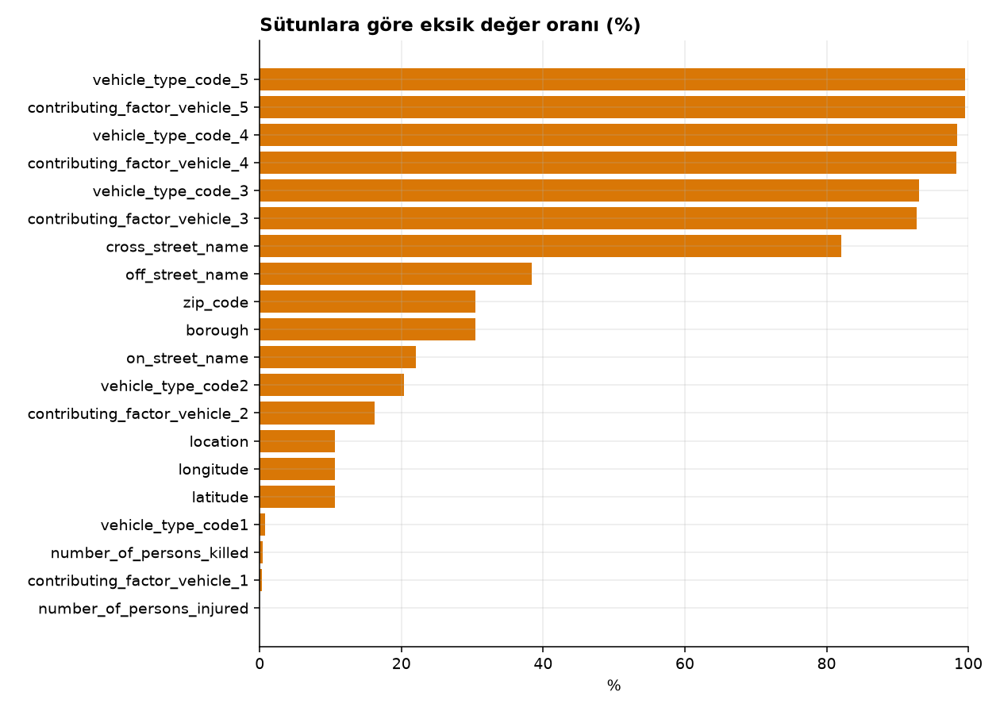
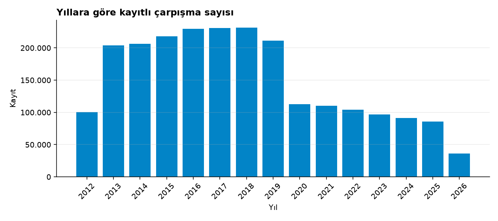
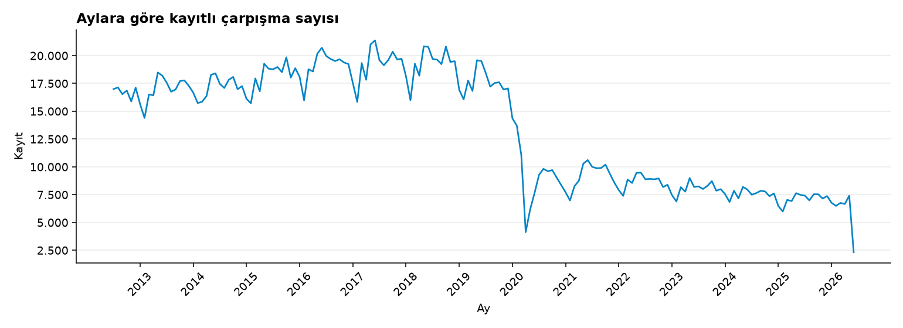
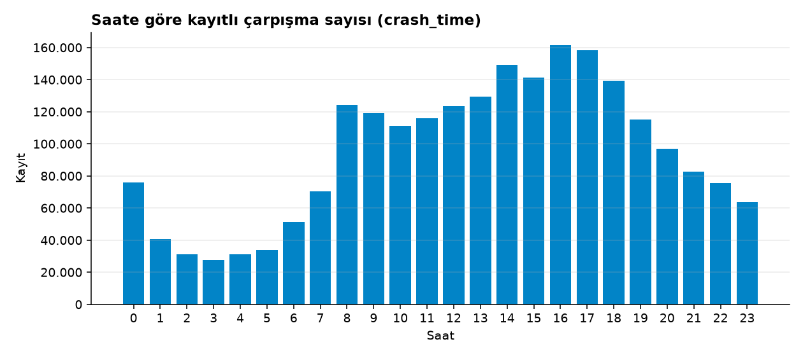
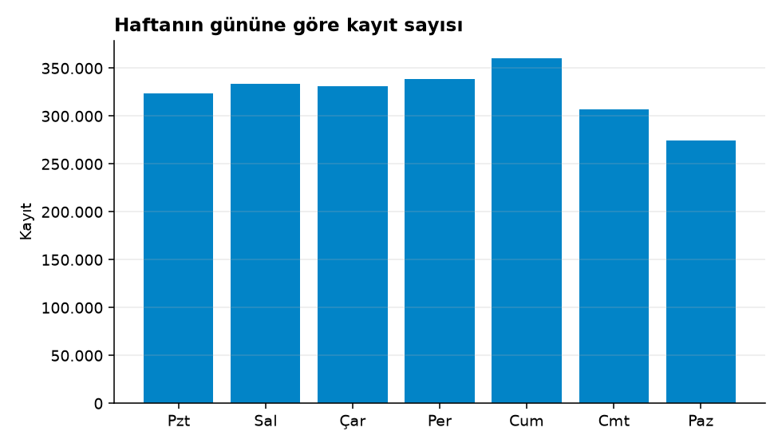
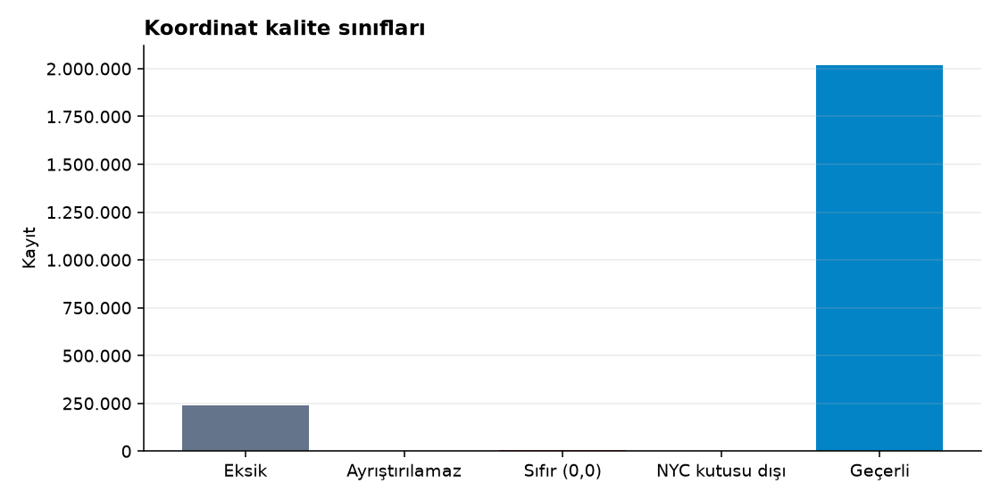
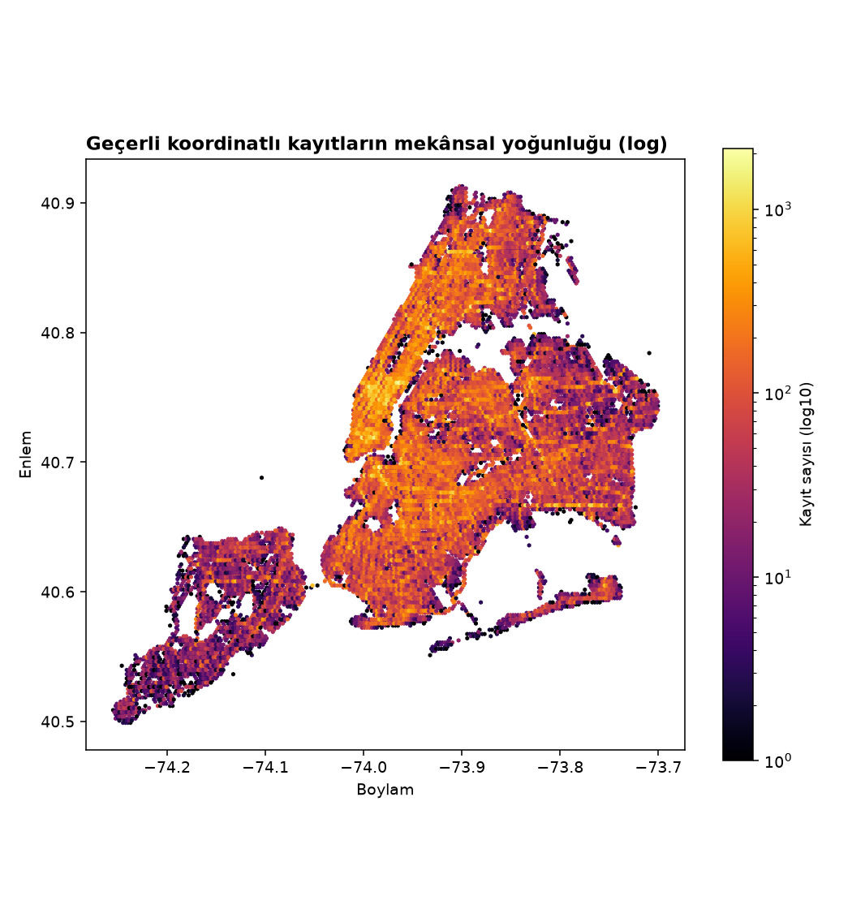
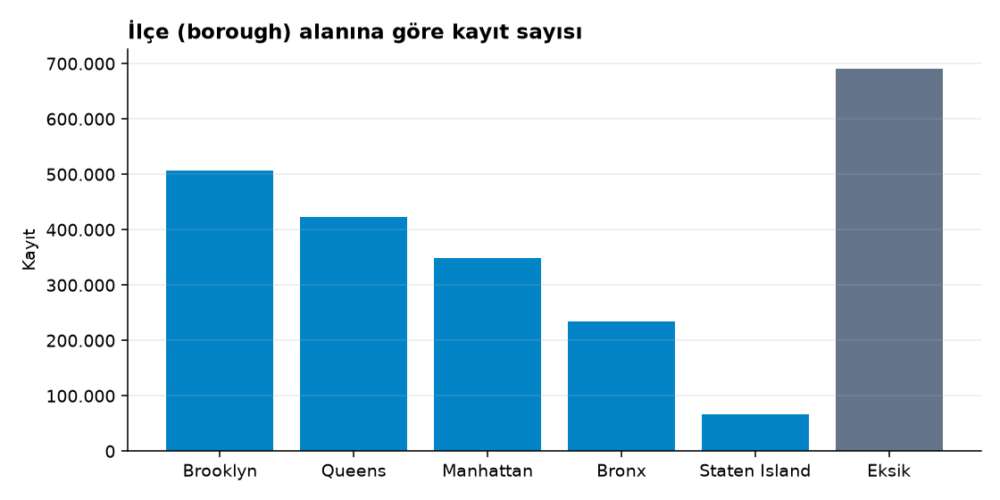
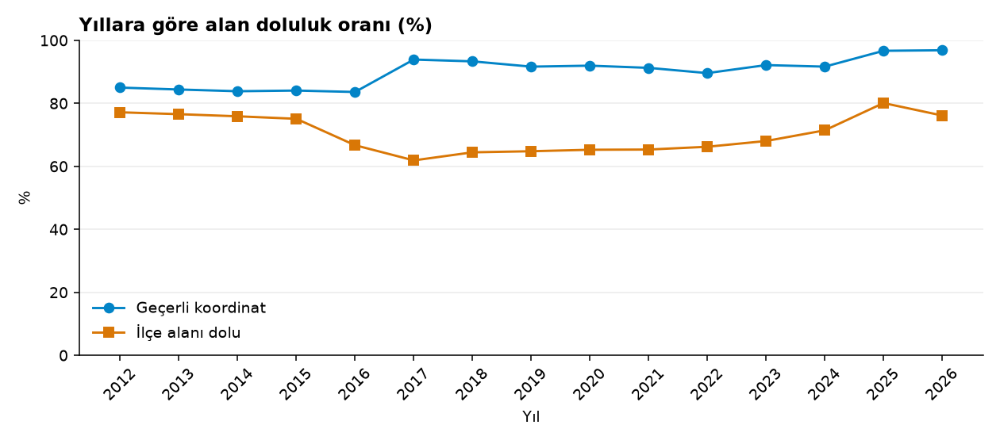
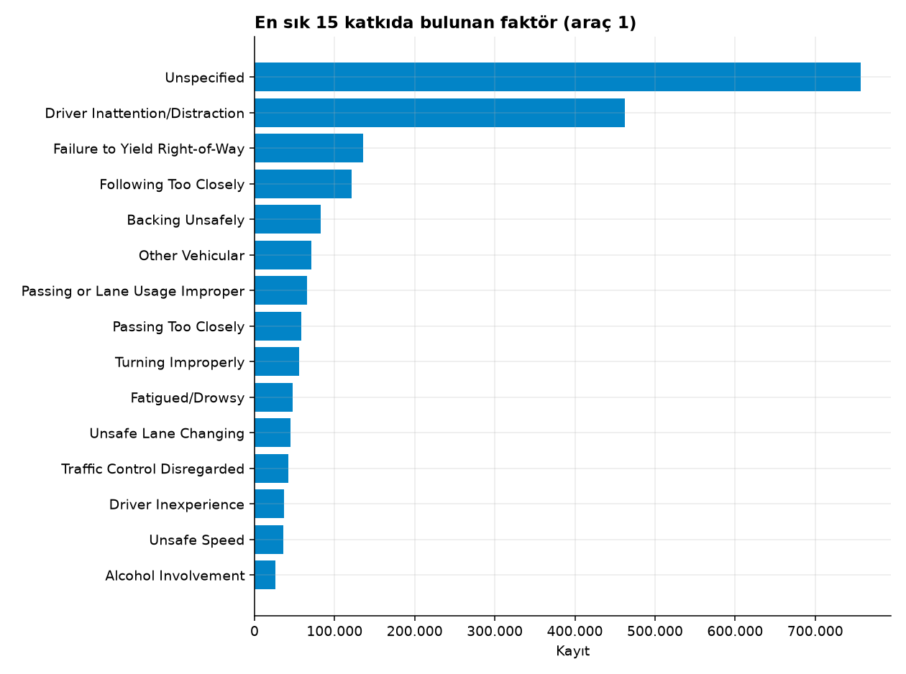

# Faz 1 — Otomatik EDA Raporu

> Bu dosya `saferoute eda` komutuyla otomatik üretilmiştir. Tüm sayılar ham anlık görüntüden ölçülmüştür.

## 1. Kaynak ve anlık görüntü

| Alan | Değer |
|---|---|
| Veri seti | Motor Vehicle Collisions - Crashes (`h9gi-nx95`) |
| Kaynak | https://data.cityofnewyork.us/d/h9gi-nx95 |
| İndirme yöntemi | Socrata SODA 2.x (CSV), `$order=:id`, sayfa boyutu 250.000 |
| İndirme başlangıç / bitiş (UTC) | 2026-10-19T15:51:15.156697+00:00 / 2026-10-19T16:01:15.101443+00:00 |
| Kaynak `rowsUpdatedAt` | 2026-06-15T23:05:47+00:00 |
| Satır / sütun | 2.269.187 / 29 |
| Sunucu sayımı (indirme sonrası) | 2.269.187 |
| Parça sayısı | 10 |
| Birleşik SHA-256 | `2fe1297c24f7aad761bca1dc3c04ec0de3459d297e06af20fbfe5e35ad10be5e` |
| Durum | complete |

## 2. Veri güncelliği

- Kaynağın son satır güncellemesi: **2026-06-15T23:05:47+00:00**
- En son kaza tarihi (`crash_date` maks.): **2026-06-11**
- Kaynak güncellemesinden indirmeye geçen süre: **125 gün**
- En son kaza tarihinden indirmeye geçen süre: **130 gün**
- Yayıncının beyan ettiği güncelleme sıklığı: Daily

Son ayların bir önceki yılın aynı ayına oranı (raporlama gecikmesi göstergesi olabilir, kanıt değildir):

| Ay | Kayıt | Önceki yıl aynı ay | Oran |
|---|---:|---:|---:|
| 2026-01 | 6.773 | 6.482 | 1,04 |
| 2026-02 | 6.492 | 5.988 | 1,08 |
| 2026-03 | 6.759 | 7.035 | 0,96 |
| 2026-04 | 6.665 | 6.924 | 0,96 |
| 2026-05 | 7.413 | 7.636 | 0,97 |
| 2026-06 (kısmi ay) | 2.322 | 7.483 | 0,31 |

*Kısmi ay: kapsam ay sonundan önce bittiği için bu ayın oranı önceki yılla karşılaştırılabilir değildir; düşüklüğün büyük kısmı eksik günlerden kaynaklanır, olası raporlama gecikmesi ayrıca dışlanamaz.*

## 3. Eksik değerler

| Sütun | Boş (null) | Yalnız boşluk | Toplam eksik | Oran |
|---|---:|---:|---:|---:|
| `crash_date` | 0 | 0 | 0 | %0,00 |
| `crash_time` | 0 | 0 | 0 | %0,00 |
| `borough` | 691.375 | 0 | 691.375 | %30,47 |
| `zip_code` | 691.661 | 42 | 691.703 | %30,48 |
| `latitude` | 240.806 | 0 | 240.806 | %10,61 |
| `longitude` | 240.806 | 0 | 240.806 | %10,61 |
| `location` | 240.806 | 0 | 240.806 | %10,61 |
| `on_street_name` | 499.179 | 15 | 499.194 | %22,00 |
| `off_street_name` | 870.147 | 17 | 870.164 | %38,35 |
| `cross_street_name` | 1.862.382 | 29 | 1.862.411 | %82,07 |
| `number_of_persons_injured` | 18 | 0 | 18 | %0,00 |
| `number_of_persons_killed` | 8.913 | 0 | 8.913 | %0,39 |
| `number_of_pedestrians_injured` | 0 | 0 | 0 | %0,00 |
| `number_of_pedestrians_killed` | 0 | 0 | 0 | %0,00 |
| `number_of_cyclist_injured` | 0 | 0 | 0 | %0,00 |
| `number_of_cyclist_killed` | 0 | 0 | 0 | %0,00 |
| `number_of_motorist_injured` | 0 | 0 | 0 | %0,00 |
| `number_of_motorist_killed` | 0 | 0 | 0 | %0,00 |
| `contributing_factor_vehicle_1` | 8.202 | 0 | 8.202 | %0,36 |
| `contributing_factor_vehicle_2` | 368.580 | 0 | 368.580 | %16,24 |
| `contributing_factor_vehicle_3` | 2.104.798 | 0 | 2.104.798 | %92,76 |
| `contributing_factor_vehicle_4` | 2.231.554 | 0 | 2.231.554 | %98,34 |
| `contributing_factor_vehicle_5` | 2.258.873 | 0 | 2.258.873 | %99,55 |
| `collision_id` | 0 | 0 | 0 | %0,00 |
| `vehicle_type_code1` | 17.081 | 0 | 17.081 | %0,75 |
| `vehicle_type_code2` | 463.107 | 0 | 463.107 | %20,41 |
| `vehicle_type_code_3` | 2.111.354 | 0 | 2.111.354 | %93,04 |
| `vehicle_type_code_4` | 2.232.943 | 0 | 2.232.943 | %98,40 |
| `vehicle_type_code_5` | 2.259.199 | 0 | 2.259.199 | %99,56 |

## 4. Kimlik ve tekrar analizi

- `collision_id` eksik: 0, tam sayı olmayan: 0
- Benzersiz `collision_id`: 2.269.187 / 2.269.187 satır
- Birden fazla satırda görülen kimlik: 0 (bu kimlikleri taşıyan satır: 0)
- Tüm sütunları birebir aynı tekrar satır: 0

## 5. Zaman alanları

- `crash_date` eksik: 0, ayrıştırılamaz: 0, saat bileşeni sıfır olmayan: 0
- Kapsam: **2012-07-01 → 2026-06-11**
- `crash_time` eksik: 0, geçersiz: 0
- Tam 00:00 olarak kayıtlı: 24.566 (%1,08) — gece yarısı yığılması, varsayılan/bilinmeyen saat girişine işaret edebilir; Faz 2'de incelenecek.

| Yıl | Kayıt |
|---|---:|
| 2012 | 100.545 |
| 2013 | 203.742 |
| 2014 | 206.046 |
| 2015 | 217.708 |
| 2016 | 229.833 |
| 2017 | 231.007 |
| 2018 | 231.564 |
| 2019 | 211.486 |
| 2020 | 112.918 |
| 2021 | 110.558 |
| 2022 | 103.887 |
| 2023 | 96.607 |
| 2024 | 91.316 |
| 2025 | 85.546 |
| 2026 | 36.424 |

## 6. Koordinatlar ve coğrafi sınır kontrolü

NYC sınırlayıcı kutusu: enlem 40.4774–40.9176, boylam -74.2591–-73.7004 (kaba kontrol; ilçe poligonu doğrulaması Faz 2).

| Sınıf | Kayıt | Oran |
|---|---:|---:|
| Eksik | 240.806 | %10,61 |
| Ayrıştırılamaz | 0 | %0,00 |
| Sıfır (0,0) | 7.591 | %0,33 |
| NYC kutusu dışı | 150 | %0,01 |
| Geçerli | 2.020.640 | %89,05 |

- Geçerli koordinatlı ama ilçe alanı boş: 487.026
- İlçe alanı dolu ama koordinatı kullanılamaz: 44.198
- `location` dolu / lat-lon eksik: 0; lat-lon dolu / `location` eksik: 0
- Geçerli koordinatlarda farklı (lat, lon) çifti: 349.124

*Not: Yoğunluk haritası ham kayıt sayısını gösterir; kümeleme sonucu veya risk ölçüsü değildir.*

## 7. İlçeler

| İlçe | Kayıt |
|---|---:|
| Brooklyn | 506.806 |
| Queens | 422.409 |
| Manhattan | 348.485 |
| Bronx | 234.088 |
| Staten Island | 66.024 |
| *Eksik* | 691.375 (%30,47) |

| Yıl | Geçerli koordinat % | İlçe dolu % |
|---|---:|---:|
| 2012 | %84,99 | %77,16 |
| 2013 | %84,39 | %76,56 |
| 2014 | %83,84 | %75,88 |
| 2015 | %84,05 | %75,09 |
| 2016 | %83,61 | %66,70 |
| 2017 | %93,90 | %61,88 |
| 2018 | %93,33 | %64,45 |
| 2019 | %91,65 | %64,79 |
| 2020 | %91,96 | %65,26 |
| 2021 | %91,26 | %65,33 |
| 2022 | %89,60 | %66,21 |
| 2023 | %92,14 | %68,04 |
| 2024 | %91,65 | %71,43 |
| 2025 | %96,68 | %80,09 |
| 2026 | %96,85 | %76,13 |

## 8. Yaralanma ve ölümler

| Sütun | Eksik | Ayrıştırılamaz | Negatif | Toplam | Maks. | >0 olan satır |
|---|---:|---:|---:|---:|---:|---:|
| `number_of_persons_injured` | 18 | 0 | 0 | 756.353 | 43 | 558.603 |
| `number_of_persons_killed` | 8.913 | 0 | 0 | 3.617 | 8 | 3.469 |
| `number_of_pedestrians_injured` | 0 | 0 | 0 | 137.819 | 27 | 132.157 |
| `number_of_pedestrians_killed` | 0 | 0 | 0 | 1.805 | 6 | 1.778 |
| `number_of_cyclist_injured` | 0 | 0 | 0 | 67.336 | 4 | 66.461 |
| `number_of_cyclist_killed` | 0 | 0 | 0 | 294 | 2 | 293 |
| `number_of_motorist_injured` | 0 | 0 | 0 | 540.227 | 43 | 353.245 |
| `number_of_motorist_killed` | 0 | 0 | 0 | 1.466 | 5 | 1.355 |

- Yaralı tutarlılığı (kişi = yaya + bisikletli + motorlu): karşılaştırılabilir 2.269.169, eşit 2.258.255, kişi > toplam 10.687, kişi < toplam 227
- Ölü tutarlılığı (kişi = yaya + bisikletli + motorlu): karşılaştırılabilir 2.260.274, eşit 2.260.190, kişi > toplam 78, kişi < toplam 6
- En az bir yaralı olan kayıt: 558.603; en az bir ölü olan kayıt: 3.469

## 9. Kategorik alanlar

- Katkıda bulunan faktör (araç 1) eksik: 8.202; "Unspecified": 756.643 (%33,34)
- 5 faktör sütunundaki farklı değer: 66
- Araç türü farklı değer: ham 3.149, büyük harf + kırpma sonrası 2.168 — Faz 2'de kategori eşlemesi gerekir.

| Dolu araç türü sütunu sayısı | Kayıt |
|---|---:|
| 0 | 17.081 |
| 1 | 446.026 |
| 2 | 1.648.247 |
| 3 | 121.589 |
| 4 | 26.256 |
| 5 | 9.988 |

| Araç türü (araç 1) | Kayıt |
|---|---:|
| Sedan | 660.172 |
| Station Wagon/Sport Utility Vehicle | 518.578 |
| PASSENGER VEHICLE | 416.206 |
| SPORT UTILITY / STATION WAGON | 180.291 |
| Taxi | 57.275 |
| 4 dr sedan | 43.871 |
| Pick-up Truck | 39.455 |
| TAXI | 31.911 |
| Box Truck | 27.179 |
| VAN | 25.266 |
| Bus | 25.192 |
| OTHER | 22.968 |
| UNKNOWN | 19.941 |
| Bike | 18.674 |
| LARGE COM VEH(6 OR MORE TIRES) | 14.397 |
| BUS | 13.993 |
| SMALL COM VEH(4 TIRES)  | 13.216 |
| Tractor Truck Diesel | 11.585 |
| PICK-UP TRUCK | 11.505 |
| LIVERY VEHICLE | 10.481 |

## 10. Metin alanları

- Posta kodu eksik: 691.703, 5 haneli olmayan: 0
- `on_street_name`: başında/sonunda boşluk olan 1.412.004; farklı değer ham 23.332 → normalize 14.669
- `off_street_name`: başında/sonunda boşluk olan 655.754; farklı değer ham 25.404 → normalize 15.843
- `cross_street_name`: başında/sonunda boşluk olan 264.268; farklı değer ham 271.300 → normalize 241.712

## 11. Çalışma süresi

Yükleme 1.53 sn, profil 30.43 sn, toplam (şekiller dahil) 36.44 sn.
Bellek izleme kapalı (`--trace-memory` ile ayrı bir koşuda ölçülür).
