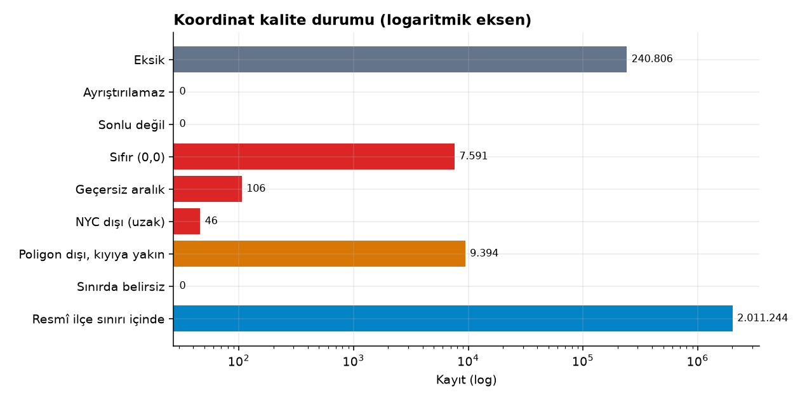
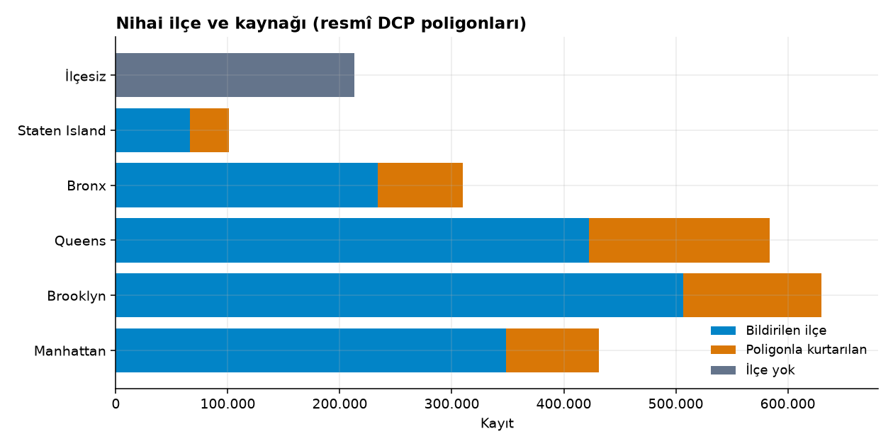
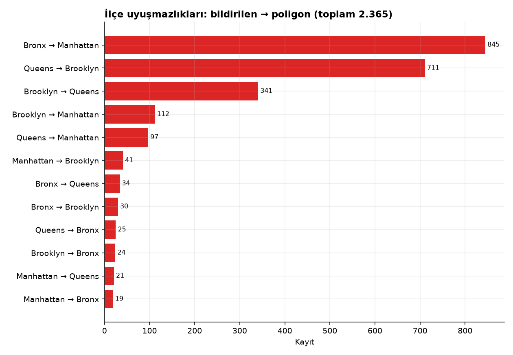
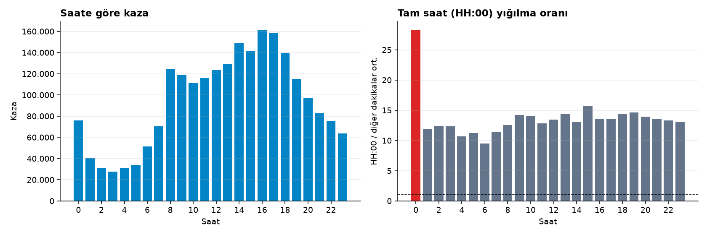
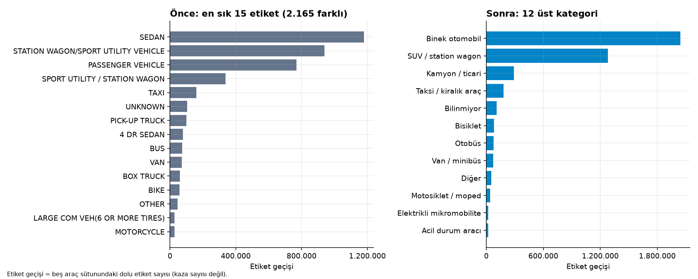
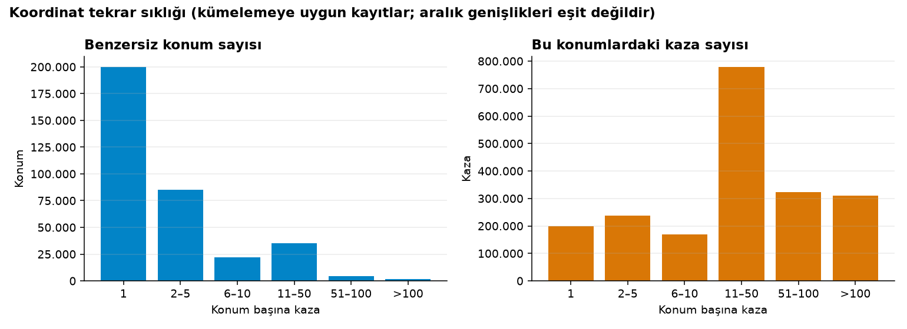
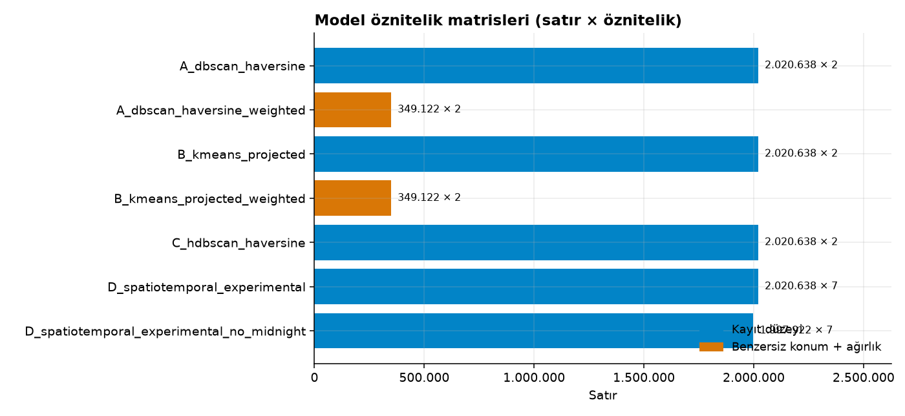
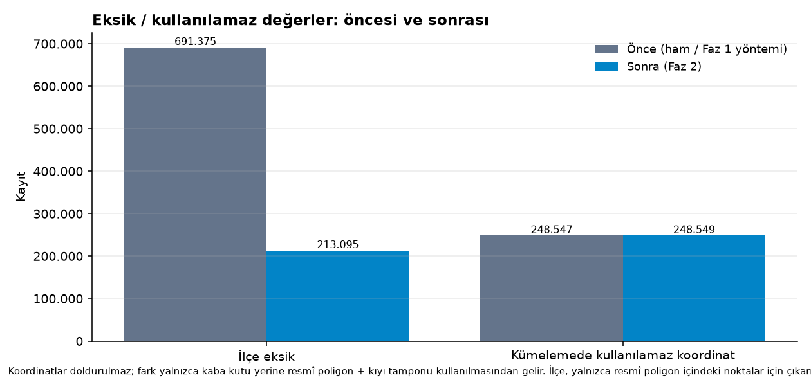

# Faz 2 — Otomatik Ön İşleme Raporu

> `saferoute preprocess` ile üretilmiştir; tüm sayılar gerçek veriden ölçülmüştür.

## 1. Soy (lineage) ve katmanlar

| Alan | Değer |
|---|---|
| Ham anlık görüntü | `snapshot_20261019T155113Z` |
| Ham birleşik SHA-256 | `2fe1297c24f7aad761bca1dc3c04ec0de3459d297e06af20fbfe5e35ad10be5e` |
| İlçe sınırları | `snapshot_20261019T170733Z`, sürüm 26b, SHA-256 `7aa44d9fb611f2f518a226ff994a6516a261a8ce982ccf1e7b37d663687f443c` |
| Yapılandırma SHA-256 | `c7ffbfdc478d9dfbe91d6f9e52f1653de5be485f3ffdec931ad848ba0d0f6985` (hat sürümü 2.1.1) |
| Ham veri değişmedi mi | Evet (işlem öncesi/sonrası SHA-256 aynı) |

| Katman | Satır | Sütun |
|---|---:|---:|
| raw | 2.269.187 | 29 |
| interim | 2.269.187 | 31 |
| processed | 2.269.187 | 87 |
| features/A_dbscan_haversine | 2.020.638 | 2 öznitelik |
| features/A_dbscan_haversine_weighted | 349.122 | 2 öznitelik |
| features/B_kmeans_projected | 2.020.638 | 2 öznitelik |
| features/B_kmeans_projected_weighted | 349.122 | 2 öznitelik |
| features/C_hdbscan_haversine | 2.020.638 | 2 öznitelik |
| features/D_spatiotemporal_experimental | 2.020.638 | 7 öznitelik |
| features/D_spatiotemporal_experimental_no_midnight | 1.997.922 | 7 öznitelik |

## 2. Faz 1 sayılarının doğrulanması

| Ölçüt | Faz 1 | Faz 2 (yeniden hesap) | Eşleşme |
|---|---:|---:|:---:|
| row_count | 2.269.187 | 2.269.187 | ✓ |
| column_count_raw | 29 | 29 | ✓ |
| valid_coordinates_bbox | 2.020.640 | 2.020.640 | ✓ |
| missing_coordinates | 240.806 | 240.806 | ✓ |
| zero_coordinates | 7.591 | 7.591 | ✓ |
| outside_bbox | 150 | 150 | ✓ |
| borough_missing | 691.375 | 691.375 | ✓ |
| valid_bbox_borough_missing | 487.026 | 487.026 | ✓ |
| distinct_valid_locations_bbox | 349.124 | 349.124 | ✓ |
| midnight_records | 24.566 | 24.566 | ✓ |
| vehicle_raw_distinct | 3.149 | 3.149 | ✓ |

## 3. Resmî ilçe sınırları

- Kaynak `gthc-hcne` (DCP), sürüm **26b**, yayın 2024-06-17T03:32:01+00:00, son satır güncellemesi 2026-05-26T19:35:50+00:00
- 5 ilçe, geometri türleri ['MultiPolygon'], 117 poligon parçası, tümü geçerli: True; beyan edilen CRS `urn:ogc:def:crs:OGC:1.3:CRS84` → `EPSG:4326`
- Alan (km², EPSG:32618): Manhattan 59,11, Bronx 110,23, Brooklyn 179,61, Queens 282,40, Staten Island 150,74
- İlçeler arası en büyük örtüşme: 9.02e-06 m² (kayan nokta düzeyi)

## 4. Koordinat kalitesi

| Durum | Kayıt | Oran |
|---|---:|---:|
| Eksik (`missing`) | 240.806 | %10,61 |
| Ayrıştırılamaz (`unparseable`) | 0 | %0,00 |
| Sonlu değil (`non_finite`) | 0 | %0,00 |
| Sıfır (0,0) (`zero`) | 7.591 | %0,33 |
| Geçersiz aralık (`invalid_range`) | 106 | <%0,01 |
| NYC dışı (uzak) (`outside_nyc_far`) | 46 | <%0,01 |
| Poligon dışı, kıyıya yakın (`outside_nyc_nearshore`) | 9.394 | %0,41 |
| Sınırda belirsiz (`boundary_ambiguous`) | 0 | %0,00 |
| Resmî ilçe sınırı içinde (`valid_in_boundary`) | 2.011.244 | %88,63 |

- Geçerli coğrafi kayıt: **2.020.638**; mekânsal kümelemeye uygun: **2.020.638**
- Yüklem karşılaştırması (349.140 benzersiz nokta): intersects/covered_by 348.824, contains (yalnız iç) 348.824, sınır çizgisi üstünde 0, birden çok ilçede 0
- Poligon dışı noktaların NYC karasına uzaklığı: medyan 33,50 m, %95 210,10 m, %99 470,80 m, maks. 3.608.284 m
  - Kümülatif: ≤25 m: 3.442, ≤50 m: 5.403, ≤100 m: 6.732, ≤200 m: 8.957, ≤300 m: 9.294, ≤500 m: 9.394, ≤1000 m: 9.394, ≤5000 m: 9.397
- Çakışan nedenler: geçersiz koordinat ∧ ilçe eksik 204.351; geçersiz koordinat ∧ 00:00 1.850; geçersiz koordinat ∧ yaralı bayrağı ≠ ok 741
- Projeksiyon EPSG:32618 (WGS 84 / UTM zone 18N): tüm noktalar kullanım alanında: True; gidiş-dönüş hatası maks. 2.83e-09 m. Referans: WGS84 elipsoidi jeodezik mesafe (pyproj.Geod) (19.998 rastgele çift, tohum 0):
  - UTM Öklid mesafesinin göreli hatası: medyan 0.00030, maks. 0.00035 (işaretli ortalama -0.00030)
  - Küresel Haversine'in göreli hatası (küre yaklaşımı): medyan 0.00114, maks. 0.00255

## 5. İlçe çıkarımı

- Bildirilen ilçe eksik: 691.375
- **Poligonla kurtarılan: 478.280**
- **Hâlâ ilçesiz: 213.095** — nedenler: geçerli koordinat yok 204.307, poligon dışında 8.788
- Poligon dışında kalan (ilçe atanmayan) kayıt: 9.440
- **İlçe uyuşmazlığı: 2.365** (bildirilen ve çıkarılan ilçesi olan 1.532.964 kaydın %0,15'i)

| Nihai ilçe | Kayıt |
|---|---:|
| Brooklyn | 630.225 |
| Queens | 583.520 |
| Manhattan | 431.245 |
| Bronx | 309.833 |
| (eksik) | 213.095 |
| Staten Island | 101.269 |

Çelişkili noktaların **bildirilen** ilçe poligonuna uzaklığı: medyan 126,80 m, %90 7.045,30 m, %99 20.618,60 m, maks. 34.265 m. Kümülatif: ≤10 m: 895, ≤50 m: 966, ≤100 m: 1.103, ≤250 m: 1.554, ≤500 m: 1.706, ≤1000 m: 1.786

**Yedek geokodlama şüphesi** (aynı koordinatta >= 3 farklı bildirilmiş ilçe): 15 konum, 1.844 kayıt; yıllara göre: 2014: 1, 2015: 1, 2016: 853, 2017: 303, 2018: 268, 2019: 215, 2020: 82, 2021: 56, 2022: 29, 2023: 27, 2024: 9. Bu kayıtlar silinmedi, `geocode_fallback_suspect_flag` ile işaretlendi.

En sık çelişki konumları:

| Enlem | Boylam | Bildirilen | Poligon | Kayıt | Bildirilene uzaklık (m) | Cadde | Kesişen |
|---:|---:|---|---|---:|---:|---|---|
| 40.873642 | -73.907970 | Bronx | Manhattan | 59 | 43,80 | — | — |
| 40.875683 | -73.908378 | Bronx | Manhattan | 58 | 137,70 | BROADWAY | WEST 228 STREET |
| 40.713600 | -74.009100 | Brooklyn | Manhattan | 54 | 1.594,50 | FLUSHING AVENUE | ATLANTIC AVENUE |
| 40.733900 | -73.954200 | Queens | Brooklyn | 38 | 644,10 | 168 STREET | 90 AVENUE |
| 40.875640 | -73.908360 | Bronx | Manhattan | 32 | 134,80 | WEST 228 STREET | BROADWAY |
| 40.877221 | -73.909045 | Bronx | Manhattan | 32 | 96,30 | MARBLE HILL AVENUE | MARBLE HILL AVENUE |
| 40.724400 | -73.981800 | Queens | Manhattan | 31 | 2.263 | 130 STREET | 90 AVENUE |
| 40.713600 | -74.009100 | Queens | Manhattan | 31 | 4.818,20 | GRAND AVENUE | PINEVILLE LANE |
| 40.699531 | -73.911037 | Queens | Brooklyn | 28 | 1,20 | MYRTLE AVENUE | WYCKOFF AVENUE |
| 40.683190 | -73.866300 | Brooklyn | Queens | 20 | 0,30 | ATLANTIC AVENUE | ELDERTS LANE |
| 40.699938 | -73.911808 | Queens | Brooklyn | 19 | 0,90 | GATES AVENUE | WYCKOFF AVENUE |
| 40.704311 | -73.913292 | Queens | Brooklyn | 18 | 0,10 | CYPRESS AVENUE | GREENE AVENUE |

## 6. Zaman öznitelikleri ve 00:00

- Şüpheli 00:00 kaydı: **24.566** (%1,08)
- Tam saat yığılma oranı (HH:00 / diğer dakikalar ort.): 00:00 için **28,29**, diğer saatlerin medyanı 13,31, en yükseği 15,71
- Gün dilimleri: öğleden sonra (12–18) 862.976, sabah (06–12) 592.449, akşam (18–24) 573.419, gece (00–06) 240.343

## 7. Araç türü standardizasyonu

- Ham farklı etiket: 3.149 → normalize: 2.165 → üst kategori: 12
- Eşleşmeyen (`unmatched` → Diğer) etiket: 1.473, etiket geçişi: 5.754 (%0,14)

| Kategori | Etiket geçişi |
|---|---:|
| Binek otomobil (`PASSENGER_CAR`) | 2.041.765 |
| SUV / station wagon (`SUV`) | 1.280.685 |
| Kamyon / ticari (`TRUCK_COMMERCIAL`) | 291.719 |
| Taksi / kiralık araç (`TAXI_FOR_HIRE`) | 181.229 |
| Bilinmiyor (`UNKNOWN`) | 106.872 |
| Bisiklet (`BICYCLE`) | 78.703 |
| Otobüs (`BUS`) | 75.905 |
| Van / minibüs (`VAN`) | 71.626 |
| Diğer (`OTHER`) | 54.085 |
| Motosiklet / moped (`MOTORCYCLE`) | 40.690 |
| Elektrikli mikromobilite (`E_MICROMOBILITY`) | 20.893 |
| Acil durum aracı (`EMERGENCY`) | 18.079 |

| Kural | Etiket geçişi |
|---|---:|
| `passenger_car` | 2.041.765 |
| `suv` | 1.280.685 |
| `truck_commercial` | 290.601 |
| `taxi_for_hire` | 181.229 |
| `unknown_tokens` | 106.872 |
| `bicycle` | 78.703 |
| `bus` | 75.905 |
| `van` | 71.626 |
| `other_explicit` | 45.953 |
| `motorcycle` | 40.690 |
| `e_micromobility` | 20.893 |
| `emergency` | 18.079 |
| `unmatched` | 5.754 |
| `special_equipment` | 1.466 |
| `refrigerated_truck` | 1.118 |
| `ambiguous_scooter` | 912 |

En sık eşleşmeyen etiketler: `STANDING S` (1.413), `UN/C` (245), `ESST` (199), `PALLET` (138), `ELECT` (135), `UN/T` (121), `STREE` (63), `FORD` (58), `C1` (50), `UN/V` (49), `SELF` (44), `POWER` (40), `CONST` (39), `PSD` (31), `OMT` (27)

Tam eşleme tablosu: `reports/phase2/vehicle_type_mapping.csv`.

## 8. Yaralanma ve ölüm tutarlılığı

| Bayrak | Yaralı | Ölü |
|---|---:|---:|
| Negatif değer | 0 | 0 |
| Toplam eksik | 18 | 8.913 |
| Alt alan eksik | 0 | 0 |
| Toplam < alt alanlar | 227 | 6 |
| Toplam > alt alanlar | 10.687 | 78 |
| Tutarlı | 2.258.255 | 2.260.190 |
| **En az bir bildirim (has_reported_*)** | 558.805 | 3.494 |

## 9. Tekrarlanan koordinatlar

- Uygun kayıt 2.020.638, benzersiz konum **349.122**, konum başına ortalama 5,79, medyan 1, maks. 887
- Tekrarlı konum 149.166; bu konumlardaki kaza 1.820.682 (%90,10)

| Konum başına kaza | Konum | Kaza |
|---|---:|---:|
| 1 | 199.956 | 199.956 |
| 2–5 | 85.280 | 238.627 |
| 6–10 | 22.111 | 169.335 |
| 11–50 | 35.127 | 778.910 |
| 51–100 | 4.716 | 322.642 |
| >100 | 1.932 | 311.168 |

Tek başına DBSCAN çekirdeği olan konumlar (ağırlık ≥ min_samples, eps'ten bağımsız):

| min_samples | Konum | Bu konumlardaki kaza |
|---:|---:|---:|
| 5 | 72.012 | 1.622.685 |
| 10 | 44.920 | 1.444.170 |
| 20 | 23.820 | 1.154.779 |
| 50 | 6.889 | 645.860 |
| 100 | 1.980 | 315.968 |

En çok tekrarlanan konumlar:

| # | Enlem | Boylam | Kaza | İlçe | Cadde | Kesişen |
|---:|---:|---:|---:|---|---|---|
| 1 | 40.608757 | -74.038086 | 887 | — | VERRAZANO BRIDGE UPPER | — |
| 2 | 40.696033 | -73.984530 | 712 | Brooklyn | TILLARY STREET | TILLARY STREET |
| 3 | 40.861862 | -73.912820 | 685 | Bronx | WEST FORDHAM ROAD | MAJOR DEEGAN EXPRESSWAY |
| 4 | 40.804700 | -73.912430 | 597 | Bronx | BRUCKNER BOULEVARD | EAST 138 STREET |
| 5 | 40.696035 | -73.984529 | 587 | Brooklyn | TILLARY STREET | FLATBUSH AVENUE EXTENSION |
| 6 | 40.675735 | -73.896860 | 581 | Brooklyn | PENNSYLVANIA AVENUE | ATLANTIC AVENUE |
| 7 | 40.658577 | -73.890630 | 527 | Brooklyn | PENNSYLVANIA AVENUE | LINDEN BOULEVARD |
| 8 | 40.604153 | -74.051980 | 510 | — | VERRAZANO BRIDGE UPPER | — |
| 9 | 40.798256 | -73.827440 | 477 | — | BRONX WHITESTONE BRIDGE | — |
| 10 | 40.760601 | -73.964314 | 474 | Manhattan | EAST 59 STREET | 2 AVENUE |
| 11 | 40.838010 | -73.873290 | 470 | Bronx | BRONX RIVER PARKWAY | — |
| 12 | 40.770770 | -73.917270 | 470 | Queens | 31 STREET | 31 STREET |
| 13 | 40.704494 | -73.817430 | 469 | Queens | VAN WYCK EXPWY | — |
| 14 | 40.820305 | -73.890830 | 467 | Bronx | BRUCKNER BOULEVARD | HUNTS POINT AVENUE |
| 15 | 40.757232 | -73.989792 | 456 | Manhattan | WEST 42 STREET | 8 AVENUE |

## 10. Öznitelik matrisleri

| Dosya | Model | Düzey | Öznitelikler | Satır | Ağırlık toplamı | Sonlu |
|---|---|---|---|---:|---:|:---:|
| `A_dbscan_haversine` | DBSCAN (A) | record | lat_rad, lon_rad | 2.020.638 | — | ✓ |
| `A_dbscan_haversine_weighted` | DBSCAN (A, ağırlıklı) | unique_location | lat_rad, lon_rad | 349.122 | 2.020.638 | ✓ |
| `B_kmeans_projected` | K-Means (B) | record | x_m, y_m | 2.020.638 | — | ✓ |
| `B_kmeans_projected_weighted` | K-Means (B, ağırlıklı) | unique_location | x_m, y_m | 349.122 | 2.020.638 | ✓ |
| `C_hdbscan_haversine` | HDBSCAN (C) | record | lat_rad, lon_rad | 2.020.638 | — | ✓ |
| `D_spatiotemporal_experimental` | Uzay-zaman (D, deneysel) | record | x_m, y_m, days_since_epoch, hour_sin, hour_cos, dow_sin, dow_cos | 2.020.638 | — | ✓ |
| `D_spatiotemporal_experimental_no_midnight` | Uzay-zaman (D, duyarlılık: 00:00 hariç) | record | x_m, y_m, days_since_epoch, hour_sin, hour_cos, dow_sin, dow_cos | 1.997.922 | — | ✓ |

## 11. Çalışma süresi ve bellek

| Adım | Süre (sn) | Bellek tepe (MB) |
|---|---:|---:|
| verify_inputs | 0,88 | 160,80 |
| load_raw | 1,10 | 1.004,50 |
| standardize | 28,17 | 2.353,30 |
| geo_borough | 9,62 | 2.353,30 |
| temporal | 1,23 | 2.353,30 |
| vehicles | 9,58 | 2.353,30 |
| casualties | 1,46 | 2.353,30 |
| coordinates | 5,02 | 2.353,30 |
| locations_features | 11,68 | 3.722,80 |
| verify_raw_unchanged | 0,99 | 3.722,80 |
| **Toplam** | 98,83 | 3.722,80 |
