# Faz 3 — Otomatik Kümeleme Deney Raporu

> `saferoute cluster` ile üretilmiştir; tüm değerler deney kaydından ve `results.json`'dan okunmuştur.

- Veri sürümü: `raw:2fe1297c24f7|p2cfg:c7ffbfdc478d|p2:2.1.1` · İşlem sürümü: `phase3-code:3.0.0|phase3-config:977132f9821d`
- Deney sayısı: 115 — durumlar: {'success': 114, 'skipped_resource_limit': 1} · Aşama süreleri toplamı: 636,9 sn (kontrol noktalı parçalar hâlinde çalıştırıldı)
- Yazılım: scikit-learn 1.9.1, hdbscan 0.8.44, numpy 2.5.4, Python 3.12.10

## 1. Veri ve matris bütünlüğü

Ham 2.269.187 kayıt · uygun olay 2.020.638 · benzersiz konum 349.122 · ağırlık toplamı 2.020.638 · 00:00 toplam 24.566 (uygun kümede 22.716, dışında 1.850) · D (00:00 hariç) 1.997.922 satır.

| Kontrol | Sonuç | Ayrıntı |
|---|:---:|---|
| `collision_id_unique` | ✓ | 2269187 |
| `processed_rows_match_sidecar` | ✓ | {'rows': 2269187, 'sidecar': 2269187} |
| `A_dbscan_haversine_rows_equal_eligible` | ✓ | 2020638 |
| `A_dbscan_haversine_order_matches` | ✓ |  |
| `B_kmeans_projected_rows_equal_eligible` | ✓ | 2020638 |
| `B_kmeans_projected_order_matches` | ✓ |  |
| `C_hdbscan_haversine_rows_equal_eligible` | ✓ | 2020638 |
| `C_hdbscan_haversine_order_matches` | ✓ |  |
| `D_spatiotemporal_experimental_rows_equal_eligible` | ✓ | 2020638 |
| `D_spatiotemporal_experimental_order_matches` | ✓ |  |
| `A_values_match_processed` | ✓ |  |
| `B_values_match_processed` | ✓ |  |
| `location_ids_contiguous` | ✓ | 349122 |
| `weights_equal_event_counts` | ✓ | 2020638 |
| `weighted_matrices_match_locations` | ✓ |  |
| `event_coords_equal_location_coords` | ✓ |  |
| `D_no_midnight_reconciles` | ✓ | {'eligible': 2020638, 'midnight_in_eligible': 22716, 'D_no_midnight_rows': 1997922} |
| `no_nan_in_features` | ✓ |  |

## 2. Ağırlıklı k-mesafe

| k | 0 m payı | p25 | p50 | p75 | p90 | p95 |
|---:|---:|---:|---:|---:|---:|---:|
| 10 | %72,0 | 0,0 | 0,0 | 0,4 | 29,1 | 51,1 |
| 25 | %51,5 | 0,0 | 0,0 | 20,5 | 69,4 | 83,0 |
| 50 | %32,2 | 0,0 | 1,0 | 65,0 | 88,8 | 118,1 |
| 100 | %15,6 | 0,7 | 57,8 | 88,3 | 141,0 | 165,8 |

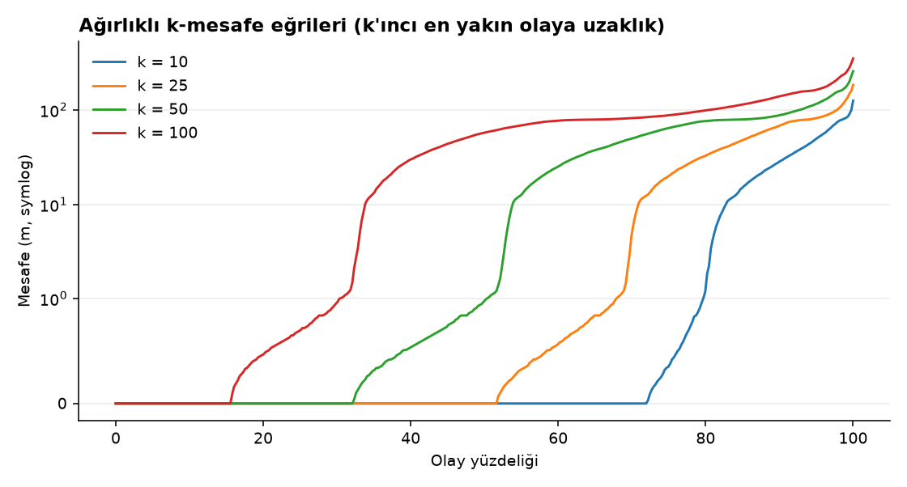

## 3. Ağırlıklı DBSCAN eşdeğerliği (gerçek veri)

| Senaryo | eps | ms | Olay | Benzersiz | Çekirdek aynı | Gürültü aynı | Çekirdek ARI | Tüm ARI | Farklı sınır / sınır | Farklılar çok kümeli komşulukta | Çift (kayıt → ağırlıklı) | Süre sn (kayıt → ağırlıklı) |
|---|---:|---:|---:|---:|:---:|:---:|---:|---:|---:|:---:|---:|---:|
| Midtown Manhattan (çok yoğun) | 50 | 10 | 44.073 | 4.798 | ✓ | ✓ | 1,0000 | 1,000000 | 0 / 182 | ✓ | 13.096.575 → 81.890 | 1,02 → 0,11 |
| Midtown Manhattan (çok yoğun) | 50 | 25 | 44.073 | 4.798 | ✓ | ✓ | 1,0000 | 1,000000 | 0 / 765 | ✓ | 13.096.575 → 81.890 | 0,93 → 0,11 |
| Midtown Manhattan (çok yoğun) | 100 | 10 | 44.073 | 4.798 | ✓ | ✓ | 1,0000 | 1,000000 | 0 / 1 | ✓ | 33.922.131 → 285.756 | 1,48 → 0,11 |
| Midtown Manhattan (çok yoğun) | 100 | 25 | 44.073 | 4.798 | ✓ | ✓ | 1,0000 | 1,000000 | 0 / 6 | ✓ | 33.922.131 → 285.756 | 1,45 → 0,11 |
| Downtown Brooklyn (yoğun tekrar) | 50 | 10 | 15.969 | 1.414 | ✓ | ✓ | 1,0000 | 0,999995 | 1 / 128 | ✓ | 6.431.439 → 14.860 | 0,37 → 0,05 |
| Downtown Brooklyn (yoğun tekrar) | 50 | 25 | 15.969 | 1.414 | ✓ | ✓ | 1,0000 | 0,999256 | 6 / 458 | ✓ | 6.431.439 → 14.860 | 0,37 → 0,05 |
| Downtown Brooklyn (yoğun tekrar) | 100 | 10 | 15.969 | 1.414 | ✓ | ✓ | 1,0000 | 1,000000 | 0 / 7 | ✓ | 9.160.813 → 46.220 | 0,43 → 0,04 |
| Downtown Brooklyn (yoğun tekrar) | 100 | 25 | 15.969 | 1.414 | ✓ | ✓ | 1,0000 | 1,000000 | 0 / 53 | ✓ | 9.160.813 → 46.220 | 0,45 → 0,05 |
| Jamaica, Queens (orta yoğunluk) | 50 | 10 | 21.177 | 3.683 | ✓ | ✓ | 1,0000 | 0,999798 | 9 / 272 | ✓ | 2.702.077 → 38.285 | 0,32 → 0,06 |
| Jamaica, Queens (orta yoğunluk) | 50 | 25 | 21.177 | 3.683 | ✓ | ✓ | 1,0000 | 0,999369 | 17 / 1.001 | ✓ | 2.702.077 → 38.285 | 0,24 → 0,06 |
| Jamaica, Queens (orta yoğunluk) | 100 | 10 | 21.177 | 3.683 | ✓ | ✓ | 1,0000 | 1,000000 | 0 / 13 | ✓ | 5.715.195 → 108.675 | 0,37 → 0,07 |
| Jamaica, Queens (orta yoğunluk) | 100 | 25 | 21.177 | 3.683 | ✓ | ✓ | 1,0000 | 1,000000 | 0 / 127 | ✓ | 5.715.195 → 108.675 | 0,45 → 0,09 |
| Staten Island kuzey (seyrek) | 50 | 10 | 11.913 | 3.824 | ✓ | ✓ | 1,0000 | 0,999599 | 31 / 606 | ✓ | 579.569 → 29.326 | 0,14 → 0,07 |
| Staten Island kuzey (seyrek) | 50 | 25 | 11.913 | 3.824 | ✓ | ✓ | 1,0000 | 0,999333 | 67 / 1.257 | ✓ | 579.569 → 29.326 | 0,15 → 0,06 |
| Staten Island kuzey (seyrek) | 100 | 10 | 11.913 | 3.824 | ✓ | ✓ | 1,0000 | 0,999990 | 7 / 191 | ✓ | 1.180.001 → 80.692 | 0,19 → 0,09 |
| Staten Island kuzey (seyrek) | 100 | 25 | 11.913 | 3.824 | ✓ | ✓ | 1,0000 | 0,999998 | 1 / 865 | ✓ | 1.180.001 → 80.692 | 0,17 → 0,07 |
| Tüm şehir, 2019 yılı | 50 | 10 | 193.820 | 67.582 | ✓ | ✓ | 1,0000 | 0,999998 | 217 / 9.433 | ✓ | 3.272.374 → 177.164 | 3,97 → 0,74 |

Tam veri kayıt düzeyi denemesi (`dbscan-89570d3913`): **skipped_resource_limit** — Tahmini komşu çifti 310,691,918 > sınır 300,000,000 (~2.3 GiB yalnızca indeks); koşu çalıştırılmadı.

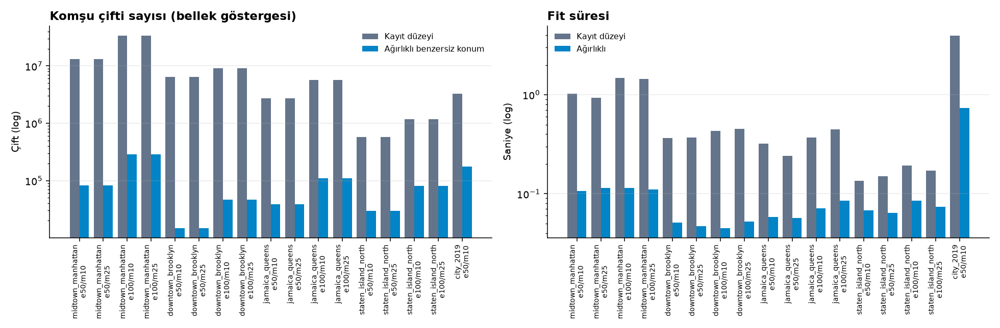

## 4. DBSCAN ızgarası (tam veri, ağırlıklı)

| eps | ms | Durum | Küme | Gürültü | En büyük pay | Siluet ortak | Siluet haversine | DB | DBCV | Kararlılık ARI | Fit sn | Fit MB | Kabul |
|---:|---:|---|---:|---:|---:|---:|---:|---:|---:|---:|---:|---:|---|
| 25 | 10 | ✓ | 31.615 | 0,093 | 0,0022 | 0,839 | 0,839 | 0,199 | 0,776 | 0,197 | 4,3 | 138 | ✓ |
| 25 | 25 | ✓ | 19.619 | 0,205 | 0,0013 | 0,911 | 0,911 | 0,127 | 0,718 | 0,357 | 4,1 | 138 | ✓ |
| 25 | 50 | ✓ | 10.462 | 0,376 | 0,0010 | 0,927 | 0,927 | 0,111 | 0,576 | 0,440 | 3,8 | 138 | ✓ |
| 25 | 100 | ✓ | 4.179 | 0,597 | 0,0007 | 0,945 | 0,945 | 0,090 | 0,394 | 0,480 | 3,9 | 138 | ✓ |
| 50 | 10 | ✓ | 15.038 | 0,034 | 0,1157 | 0,049 | 0,049 | 0,668 | 0,084 | 0,183 | 4,5 | 138 | ✗ en büyük küme payı 0.116 > 0.05 |
| 50 | 25 | ✓ | 10.245 | 0,101 | 0,0877 | 0,202 | 0,202 | 0,624 | 0,255 | 0,284 | 5,0 | 138 | ✗ en büyük küme payı 0.088 > 0.05 |
| 50 | 50 | ✓ | 7.134 | 0,213 | 0,0486 | 0,348 | 0,348 | 0,534 | 0,337 | 0,301 | 4,7 | 138 | ✓ |
| 50 | 100 | ✓ | 4.570 | 0,396 | 0,0122 | 0,517 | 0,517 | 0,406 | 0,352 | 0,290 | 4,8 | 138 | ✓ |
| 100 | 10 | ✓ | 890 | 0,002 | 0,5570 | -0,731 | -0,731 | 1,185 | -0,830 | 0,631 | 6,2 | 201 | ✗ en büyük küme payı 0.557 > 0.05 |
| 100 | 25 | ✓ | 911 | 0,010 | 0,5109 | -0,696 | -0,696 | 1,043 | -0,758 | 0,661 | 5,8 | 193 | ✗ en büyük küme payı 0.511 > 0.05 |
| 100 | 50 | ✓ | 948 | 0,032 | 0,4690 | -0,650 | -0,650 | 0,855 | -0,710 | 0,555 | 6,0 | 187 | ✗ en büyük küme payı 0.469 > 0.05 |
| 100 | 100 | ✓ | 990 | 0,098 | 0,3145 | -0,549 | -0,549 | 0,790 | -0,480 | 0,322 | 5,9 | 176 | ✗ en büyük küme payı 0.314 > 0.05 |
| 200 | 10 | ✓ | 57 | 0,000 | 0,5813 | -0,254 | -0,254 | 0,785 | -0,729 | 0,710 | 7,8 | 497 | ✗ en büyük küme payı 0.581 > 0.05 |
| 200 | 25 | ✓ | 50 | 0,001 | 0,5809 | -0,179 | -0,179 | 0,672 | -0,572 | 0,756 | 8,1 | 494 | ✗ en büyük küme payı 0.581 > 0.05 |
| 200 | 50 | ✓ | 55 | 0,002 | 0,5794 | -0,402 | -0,402 | 1,247 | -0,779 | 0,730 | 8,2 | 494 | ✗ en büyük küme payı 0.579 > 0.05 |
| 200 | 100 | ✓ | 92 | 0,008 | 0,5764 | -0,498 | -0,498 | 0,882 | -0,764 | 0,793 | 8,0 | 495 | ✗ en büyük küme payı 0.576 > 0.05 |
| 350 | 10 | ✓ | 20 | 0,000 | 0,9403 | -0,420 | -0,420 | 0,803 | -0,722 | 0,601 | 12,3 | 1.311 | ✗ en büyük küme payı 0.940 > 0.05 |
| 350 | 25 | ✓ | 15 | 0,000 | 0,9403 | -0,417 | -0,417 | 0,789 | -0,860 | 0,734 | 12,1 | 1.337 | ✗ küme sayısı 15 < 20; en büyük küme payı 0.940 > 0.05 |
| 350 | 50 | ✓ | 15 | 0,000 | 0,9403 | -0,420 | -0,420 | 0,790 | -0,855 | 0,468 | 12,3 | 1.335 | ✗ küme sayısı 15 < 20; en büyük küme payı 0.940 > 0.05 |
| 350 | 100 | ✓ | 16 | 0,001 | 0,5821 | -0,274 | -0,274 | 1,305 | -0,626 | 0,592 | 12,7 | 1.171 | ✗ küme sayısı 16 < 20; en büyük küme payı 0.582 > 0.05 |

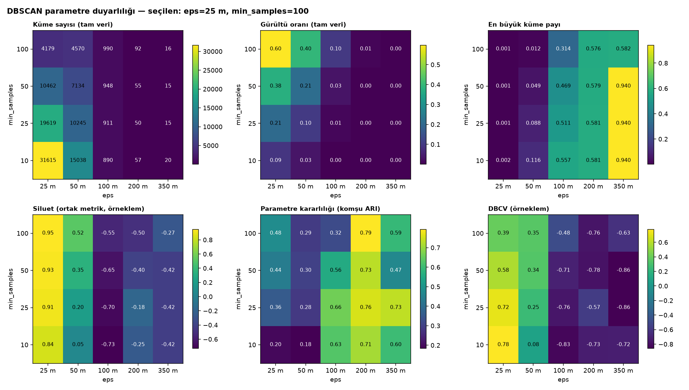

## 5. K-Means ızgarası (tam veri, ağırlıklı)

| k | Atalet (m²) | Siluet ortak | DB | DBCV | En büyük pay | Fit sn |
|---:|---:|---:|---:|---:|---:|---:|
| 5 | 4.710e+13 | 0,458 | 0,691 | -0,852 | 0,2815 | 0,8 |
| 10 | 2.263e+13 | 0,398 | 0,810 | -0,659 | 0,1439 | 1,7 |
| 20 | 1.053e+13 | 0,390 | 0,771 | -0,550 | 0,0943 | 3,2 |
| 40 | 5.111e+12 | 0,371 | 0,813 | -0,489 | 0,0542 | 7,1 |
| 80 | 2.431e+12 | 0,374 | 0,782 | -0,363 | 0,0295 | 16,1 |

Dirsek (kneedle) k = 20.

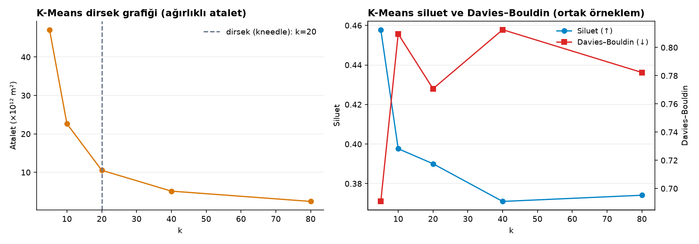

## 6. HDBSCAN ızgarası (100k olay örneklemi)

| mcs | ms | Küme | Gürültü | En büyük pay | Siluet ortak | DB | DBCV | Üyelik olasılığı medyan | Fit sn | Fit MB | Kabul |
|---:|---:|---:|---:|---:|---:|---:|---:|---:|---:|---:|---|
| 25 | 5 | 1.360 | 0,269 | 0,0086 | 0,371 | 0,832 | 0,249 | 1,000 | 70,1 | 178 | ✓ |
| 25 | 10 | 1.125 | 0,371 | 0,0086 | 0,445 | 0,694 | 0,251 | 1,000 | 69,4 | 180 | ✓ |
| 25 | 25 | 768 | 0,547 | 0,0085 | 0,601 | 0,477 | 0,260 | 1,000 | 68,9 | 180 | ✓ |
| 50 | 5 | 304 | 0,169 | 0,3592 | -0,018 | 0,970 | -0,252 | 1,000 | 68,7 | 179 | ✗ en büyük küme payı 0.359 > 0.05 |
| 50 | 10 | 474 | 0,356 | 0,0498 | 0,322 | 0,900 | 0,101 | 1,000 | 69,4 | 180 | ✓ |
| 50 | 25 | 343 | 0,508 | 0,0144 | 0,454 | 0,647 | 0,145 | 1,000 | 64,3 | 180 | ✓ |
| 100 | 5 | 4 | 0,001 | 0,5807 | 0,277 | 0,873 | -0,670 | 1,000 | 64,0 | 180 | ✗ küme sayısı 4 < 20; en büyük küme payı 0.581 > 0.05 |
| 100 | 10 | 131 | 0,232 | 0,3588 | 0,028 | 0,943 | -0,264 | 1,000 | 53,2 | 180 | ✗ en büyük küme payı 0.359 > 0.05 |
| 100 | 25 | 106 | 0,296 | 0,3552 | -0,017 | 0,728 | -0,203 | 1,000 | 53,8 | 178 | ✗ en büyük küme payı 0.355 > 0.05 |
| 250 | 5 | 4 | 0,001 | 0,5807 | 0,277 | 0,873 | -0,670 | 1,000 | 53,9 | 179 | ✗ küme sayısı 4 < 20; en büyük küme payı 0.581 > 0.05 |
| 250 | 10 | 4 | 0,002 | 0,5803 | 0,274 | 0,871 | -0,842 | 1,000 | 53,1 | 180 | ✗ küme sayısı 4 < 20; en büyük küme payı 0.580 > 0.05 |
| 250 | 25 | 4 | 0,005 | 0,9405 | 0,275 | 0,592 | -0,339 | 1,000 | 53,9 | 180 | ✗ küme sayısı 4 < 20; en büyük küme payı 0.940 > 0.05 |

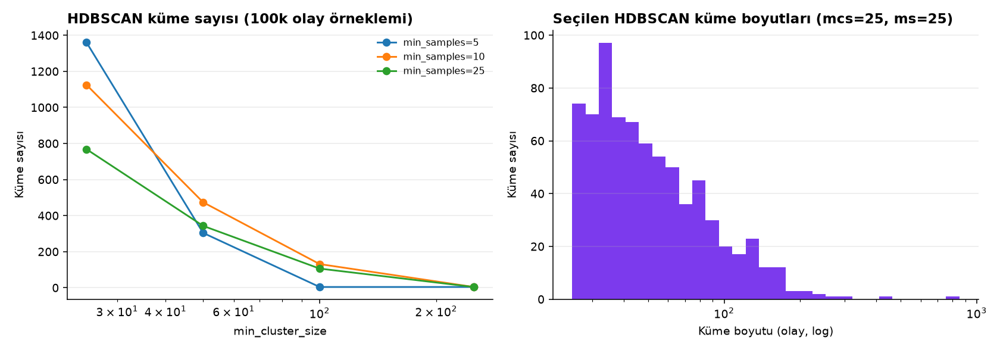

## 7. Seçilen konfigürasyonların karşılaştırması (ortak değerlendirme kümesi)

| Algoritma | Parametreler | Fit kapsamı | Küme (tam) | Gürültü (tam) | Küme (ortak) | Gürültü (ortak) | En büyük pay (ortak) | Siluet ortak | DB | DBCV | Fit sn | Fit MB |
|---|---|---|---:|---:|---:|---:|---:|---:|---:|---:|---:|---:|
| DBSCAN | `{"eps_m": 25, "min_samples": 100}` | tam veri (ağırlıklı benzersiz konum) | 4.179 | 0,597 | 4.171 | 0,596 | 0,0008 | 0,945 | 0,090 | 0,394 | 3,9 | 138 |
| K-Means | `{"k": 5}` | tam veri (ağırlıklı benzersiz konum) | 5 | 0,000 | 5 | 0,000 | 0,2803 | 0,458 | 0,691 | -0,852 | 0,8 | 139 |
| HDBSCAN | `{"min_cluster_size": 25, "min_samples": 25}` | örneklem (100k olay) | N/A | N/A | 768 | 0,547 | 0,0085 | 0,601 | 0,477 | 0,260 | 68,9 | 180 |

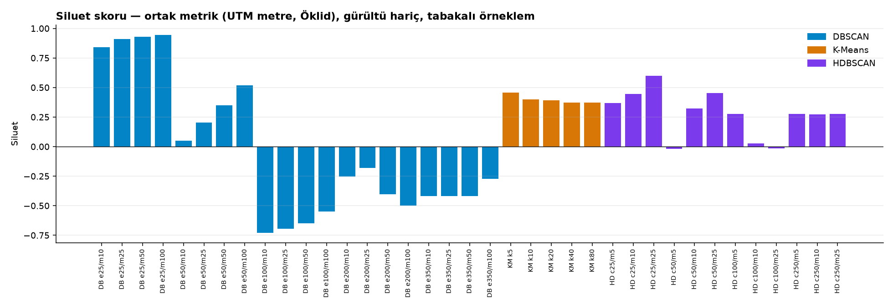

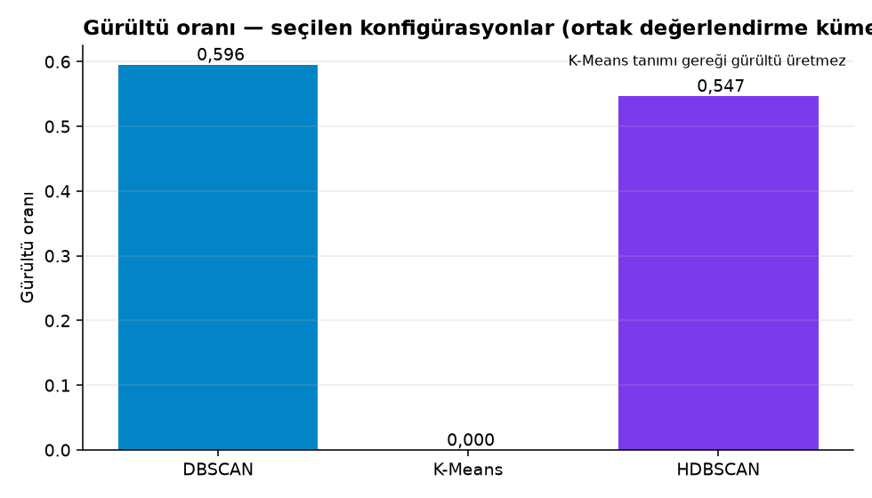

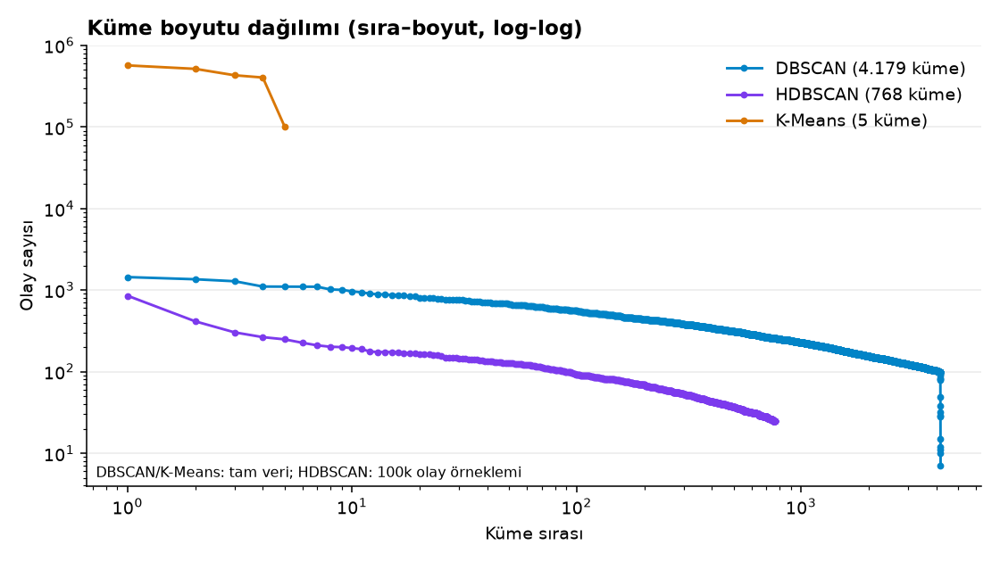

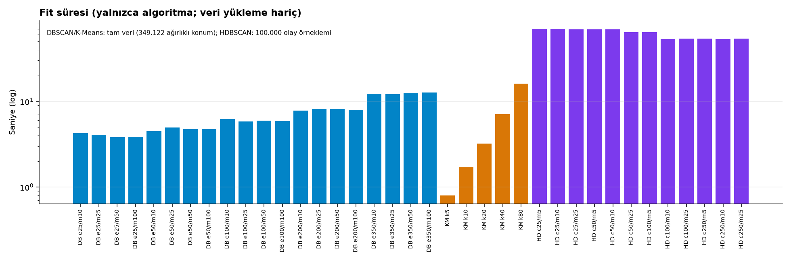

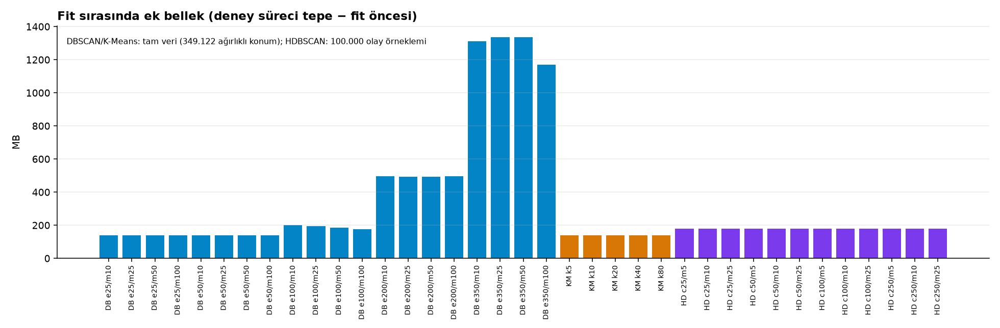

### 7.1 Seçilen DBSCAN'in gerekçe sınaması (kayıtlı etiketlerden; seçim kuralı değiştirilmez)

Uzanım = küme olaylarının UTM sınırlayıcı kutu köşegeni; uzun köşegen yoğunluk zincirlenmesinin göstergesidir. Etkin yıl = kümenin olay içerdiği yıl sayısı (2013–2025).

| eps | ms | Seçilen | Küme | Gürültü | Olay/küme medyan · maks | Konum/küme medyan | Tek konumlu küme | Uzanım medyan · p95 · maks (m) | >200 m küme | 13 yılın tamamında etkin | ARI | Siluet | DBCV |
|---:|---:|:---:|---:|---:|---:|---:|---:|---:|---:|---:|---:|---:|---:|
| 25 | 10 |  | 31.615 | 0,093 | 31 · 4.401 | 5 | %1,3 | 24 · 92 · 1.192 | %0,75 | %25,3 | 0,197 | 0,839 | 0,776 |
| 25 | 25 |  | 19.619 | 0,205 | 53 · 2.559 | 6 | %0,7 | 30 · 84 · 488 | %0,22 | %42,5 | 0,357 | 0,911 | 0,718 |
| 25 | 50 |  | 10.462 | 0,376 | 86 · 2.062 | 7 | %0,6 | 37 · 86 · 315 | %0,05 | %67,5 | 0,440 | 0,927 | 0,576 |
| 25 | 100 | ✓ | 4.179 | 0,597 | 151 · 1.444 | 8 | %0,7 | 41 · 88 · 174 | %0,00 | %85,0 | 0,480 | 0,945 | 0,394 |
| 50 | 50 |  | 7.134 | 0,213 | 97 · 98.152 | 12 | %0,3 | 103 · 400 · 7.544 | %17,80 | %72,2 | 0,301 | 0,348 | 0,337 |
| 50 | 100 |  | 4.570 | 0,396 | 153 · 24.748 | 14 | %0,3 | 109 · 323 · 4.394 | %16,21 | %86,1 | 0,290 | 0,517 | 0,352 |

- **Zincirlenme:** seçilen konfigürasyonda en geniş küme köşegeni 174 m; 200 m'yi aşan küme payı %0,00. Karşılaştırma — eps=50/ms=50: maks 7.544 m, >200 m küme payı %17,8; eps=50/ms=100: maks 4.394 m, >200 m küme payı %16,2.
- **Coğrafi ölçek:** medyan 8 benzersiz konum ve 41 m uzanım (kavşak ölçeği); tek koordinattan oluşan küme payı %0,7 — kümeler salt tekrarlanan geokod değildir.
- **Zaman sürekliliği:** 13 yılın tamamında en az bir olay içeren küme payı %85,0 (kronik sıcak nokta).
- **Bedel:** gürültü oranı %59,7; model şehir genelini değil kronik yoğunlaşmaları temsil eder. Daha düşük min_samples daha çok olayı kapsar fakat parametre kararlılığı (ARI) ve yıllar arası süreklilik düşer.
- **Siluetin yorumu:** küçük eps kümeleri kompakt ve birbirinden uzak olduğu için siluet yüksek çıkar; bu, yoğunluk yapısının değil kavşak ölçeğindeki ayrışmanın ölçüsüdür. Aynı eps'te min_samples'a göre DBCV: ms=10: 0,776, ms=25: 0,718, ms=50: 0,576, ms=100: 0,394 — gürültü payı ile yoğunluk-geçerliliği arasındaki ödünleşim.

## 8. Zamansal kararlılık

(a) = sabit parametreler (yıllık sıcak nokta); (c) = min_samples yıllık hacme ölçeklenmiş.

| Yıl | Olay | (a) Küme | (a) Gürültü | (a) Jaccard | (a) Önceki yıl kümesinde | (c) ms | (c) Küme | (c) Gürültü | (c) En büyük pay | (c) Jaccard | K-Means merkez kayması medyan (m) |
|---:|---:|---:|---:|---:|---:|---:|---:|---:|---:|---:|---:|
| 2013 | 171.941 | 13 | 0,991 | N/A | N/A | 9 | 5.445 | 0,424 | 0,0010 | N/A | N/A |
| 2014 | 172.751 | 9 | 0,994 | 0,600 | %89,2 | 9 | 5.323 | 0,435 | 0,0009 | 0,600 | 69 |
| 2015 | 182.992 | 12 | 0,992 | 0,438 | %48,3 | 9 | 5.751 | 0,425 | 0,0012 | 0,597 | 112 |
| 2016 | 192.150 | 20 | 0,984 | 0,050 | %8,0 | 10 | 4.112 | 0,581 | 0,0018 | 0,453 | 173 |
| 2017 | 216.917 | 22 | 0,985 | 0,118 | %19,1 | 11 | 4.231 | 0,579 | 0,0014 | 0,528 | 143 |
| 2018 | 216.108 | 21 | 0,986 | 0,459 | %69,8 | 11 | 4.251 | 0,582 | 0,0013 | 0,568 | 130 |
| 2019 | 193.820 | 11 | 0,993 | 0,265 | %58,7 | 10 | 4.247 | 0,585 | 0,0010 | 0,541 | 166 |
| 2020 | 103.838 | 1 | 0,999 | 0,059 | %100,0 | 5 | 5.289 | 0,546 | 0,0011 | 0,435 | 600 |
| 2021 | 100.896 | 0 | 1,000 | 0,000 | N/A | 5 | 5.222 | 0,558 | 0,0009 | 0,416 | 98 |
| 2022 | 93.080 | 0 | 1,000 | N/A | N/A | 5 | 4.619 | 0,579 | 0,0008 | 0,418 | 208 |
| 2023 | 89.014 | 0 | 1,000 | N/A | N/A | 4 | 6.377 | 0,500 | 0,0007 | 0,415 | 112 |
| 2024 | 83.692 | 0 | 1,000 | N/A | N/A | 4 | 5.793 | 0,531 | 0,0009 | 0,416 | 215 |
| 2025 | 82.704 | 1 | 0,998 | 0,000 | %0,0 | 4 | 5.052 | 0,578 | 0,0020 | 0,379 | 197 |

**Zamansal kararlılık ile kaza hacmi değişiminin ayrımı.** Yıllık olay sayısı medyanı 2013–2019'da 192.150, 2020–2025'te 91.047. (a) Sabit eşikte min_samples tam veri için seçilmiş değerdir; tek yılda bu yoğunluğa ulaşan konum çok azdır (küme medyanı 13 → 0, gürültü ≥ 0,984). Bu yüzden (a)'daki düşüş bir *kararlılık* kaybı değil, eşiğin yıllık hacme göre çok yüksek kalmasıdır; boş kapsamlı yıllarda Jaccard tanımsızdır (N/A: 2022, 2023, 2024). (a) sütunlarındaki oranlar birkaç kümeye dayandığı yıllarda (≤5 küme: 2020, 2021, 2022, 2023, 2024, 2025) istatistiksel olarak anlamlı değildir. (c) Hacme ölçekli eşikte (ms [9, 10, 11] → [4, 5]) yıllık küme sayısı benzer düzeyde kalır (4.251 → 5.256); ardışık yıl Jaccard medyanı 0,555 → 0,416. Ölçekli eşikteki bu daha küçük düşüş, hacim etkisi büyük ölçüde giderildikten sonra kalan mekânsal değişimdir; ancak ms [4, 5] düzeyine indiğinde küçük, rastlantısal kümeler de oluşabildiğinden 2020 sonrası değerler dikkatle yorumlanmalıdır. (b) Kalıcılık analizi tam veri modelinin aynı kümelerini yıllara göre izler ve hacimden bağımsız bir süreklilik ölçüsüdür.

Kalıcılık (tam veri modeli, 4.179 küme): 13 yılın tamamında etkin %85,0, 10+ yılda etkin %97,5; tüm yıllarda etkin kümelerdeki olay payı %88,0.

| Yıllar | Spearman (küme olay sayıları) | Üst-50 örtüşmesi |
|---|---:|---:|
| 2013-2014 | 0,795 | %78 |
| 2014-2015 | 0,790 | %68 |
| 2015-2016 | 0,497 | %42 |
| 2016-2017 | 0,664 | %40 |
| 2017-2018 | 0,743 | %62 |
| 2018-2019 | 0,678 | %60 |
| 2019-2020 | 0,607 | %52 |
| 2020-2021 | 0,625 | %60 |
| 2021-2022 | 0,614 | %50 |
| 2022-2023 | 0,623 | %62 |
| 2023-2024 | 0,594 | %68 |
| 2024-2025 | 0,531 | %56 |

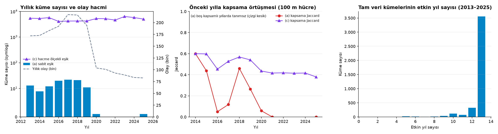

## 9. Veri kalitesi duyarlılığı

| Varyant | Hariç olay | Kırpma | Küme | Gürültü | Temel küme (ortak) | Temel gürültü (ortak) | ARI | Gürültü uyumu | Korunan temel küme | Korunan kümelerdeki olay |
|---|---:|---:|---:|---:|---:|---:|---:|---:|---:|---:|
| exclude_geocode_fallback | 1.844 | N/A | 4.175 | 0,598 | 4.178 | 0,597 | 0,9997 | 0,9999 | %99,9 | %100,0 |
| exclude_borough_conflict | 2.365 | N/A | 4.173 | 0,597 | 4.179 | 0,597 | 0,9996 | 0,9998 | %99,9 | %100,0 |
| exclude_nearshore | 9.394 | N/A | 4.152 | 0,598 | 4.154 | 0,598 | 1,0000 | 1,0000 | %100,0 | %100,0 |
| cap_repeated_weights | 0 | 73 | 4.059 | 0,607 | 4.179 | 0,597 | 0,9741 | 0,9901 | %97,1 | %97,6 |

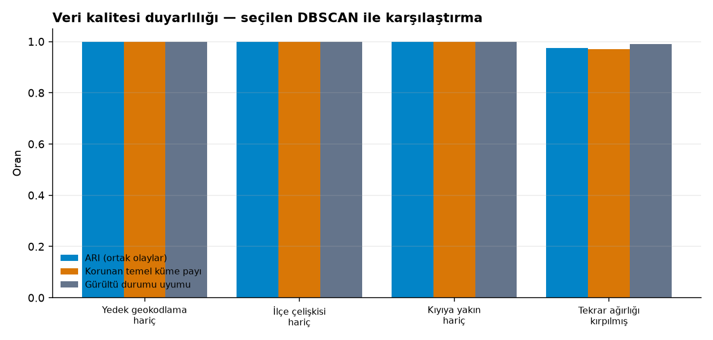

## 10. Küme profilleri (seçilen DBSCAN, olay sayısına göre ilk 15)

4.179 küme, 814.578 kümelenmiş olay; yaralanmalı 207.412, ölümlü 1.324.

| # | Olay | Konum | İlçe | Merkez (enlem, boylam) | Zarf km² | r90 m | Tarih aralığı | Yaralanmalı | Ölümlü | Zirve saat | Başlıca cadde |
|---:|---:|---:|---|---|---:|---:|---|---:|---:|---:|---|
| 1 | 1.444 | 10 | BROOKLYN | 40.69603, -73.98453 | 0,0008 | 0 | 2012-07-03 → 2026-06-03 | 203 | 1 | 12 | TILLARY STREET |
| 2 | 1.358 | 17 | BRONX | 40.82021, -73.89067 | 0,0009 | 33 | 2012-07-03 → 2026-06-09 | 366 | 1 | 16 | BRUCKNER BOULEVARD |
| 3 | 1.284 | 9 | BRONX | 40.86186, -73.91278 | 0,0002 | 4 | 2012-07-04 → 2026-06-07 | 382 | 0 | 16 | WEST FORDHAM ROAD |
| 4 | 1.105 | 26 | BROOKLYN | 40.67817, -73.89752 | 0,0030 | 14 | 2012-07-01 → 2026-06-08 | 296 | 0 | 16 | PENNSYLVANIA AVENUE |
| 5 | 1.103 | 9 | QUEENS | 40.76220, -73.75694 | 0,0002 | 18 | 2012-07-01 → 2026-06-06 | 239 | 1 | 17 | NORTHERN BOULEVARD |
| 6 | 1.100 | 12 | BROOKLYN | 40.69161, -73.99924 | 0,0004 | 14 | 2012-07-01 → 2026-05-25 | 220 | 0 | 0 | BROOKLYN QUEENS EXPRESSWAY |
| 7 | 1.099 | 16 | BROOKLYN | 40.67574, -73.89686 | 0,0008 | 0 | 2012-07-01 → 2026-05-12 | 264 | 1 | 16 | PENNSYLVANIA AVENUE |
| 8 | 1.018 | 14 | BROOKLYN | 40.65858, -73.89063 | 0,0008 | 0 | 2012-07-02 → 2026-05-26 | 295 | 2 | 14 | PENNSYLVANIA AVENUE |
| 9 | 1.007 | 29 | BRONX | 40.80470, -73.91239 | 0,0054 | 38 | 2012-07-07 → 2026-05-14 | 282 | 5 | 16 | BRUCKNER BOULEVARD |
| 10 | 965 | 8 | MANHATTAN | 40.76060, -73.96433 | 0,0003 | 1 | 2012-07-01 → 2026-05-21 | 118 | 1 | 17 | EAST 59 STREET |
| 11 | 940 | 13 | QUEENS | 40.73351, -73.87034 | 0,0008 | 3 | 2012-07-08 → 2026-05-29 | 136 | 0 | 17 | QUEENS BOULEVARD |
| 12 | 906 | 7 | BROOKLYN | 40.65191, -73.86538 | 0,0001 | 8 | 2012-07-03 → 2026-06-06 | 298 | 0 | 15 | BELT PARKWAY |
| 13 | 887 | 1 | nan | 40.60876, -74.03809 | 0,0000 | 0 | 2013-08-06 → 2026-05-11 | 230 | 0 | 9 | VERRAZANO BRIDGE UPPER |
| 14 | 885 | 10 | BROOKLYN | 40.71979, -73.94478 | 0,0005 | 11 | 2012-07-09 → 2026-06-01 | 217 | 0 | 16 | BROOKLYN QUEENS EXPRESSWAY |
| 15 | 871 | 5 | QUEENS | 40.70450, -73.81739 | 0,0000 | 14 | 2012-07-06 → 2026-06-03 | 188 | 0 | 17 | VAN WYCK EXPWY |

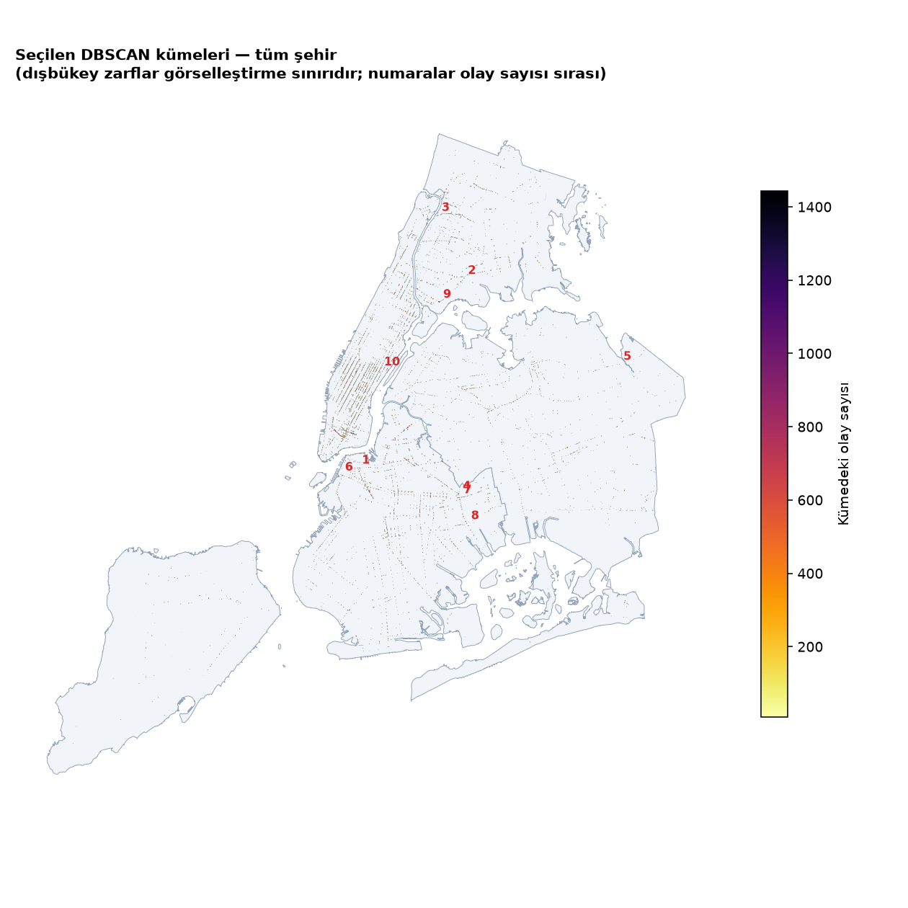

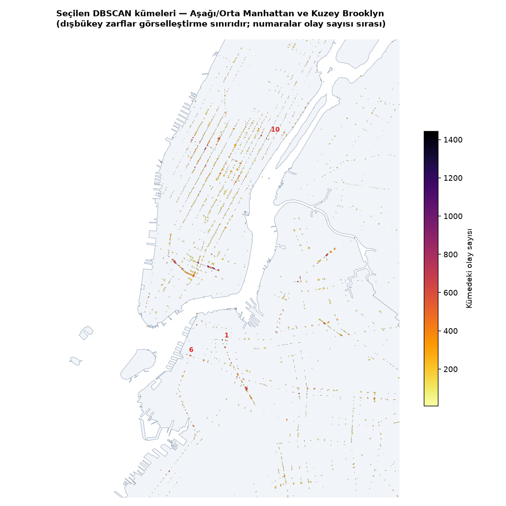

## 11. Seçim

- Seçim ölçütleri (önceden tanımlı): `{"max_largest_cluster_share": 0.05, "min_clusters": 20, "ranking": ["parameter_stability_ari", "silhouette_common"], "kmeans_rule": "silhouette_common", "hdbscan_rule": "dbcv"}`
- Seçilen: DBSCAN `dbscan-52abd2c018`, K-Means `kmeans-24c07e9946`, HDBSCAN `hdbscan-ba3a1ff58d`
- Ana model: **dbscan** — Ana model: tam veride uygulanabilen, gürültüyü ayırabilen ve kabul ölçütlerini sağlayan yoğunluk tabanlı model. Ölçütü sağlamazsa ana model seçilmez (None) ve rapor bunu belirtir.

## 12. Çıktı dosyaları

- `cluster_points_dbscan`: `data\processed\h9gi-nx95\snapshot_20261019T155113Z\phase3\cluster_points_dbscan.parquet`
- `cluster_summary_dbscan`: `data\processed\h9gi-nx95\snapshot_20261019T155113Z\phase3\cluster_summary_dbscan.parquet`
- `cluster_geometries_dbscan`: `data\processed\h9gi-nx95\snapshot_20261019T155113Z\phase3\cluster_geometries_dbscan.geojson`
- `cluster_points_kmeans`: `data\processed\h9gi-nx95\snapshot_20261019T155113Z\phase3\cluster_points_kmeans.parquet`
- `cluster_summary_kmeans`: `data\processed\h9gi-nx95\snapshot_20261019T155113Z\phase3\cluster_summary_kmeans.parquet`
- `cluster_geometries_kmeans`: `data\processed\h9gi-nx95\snapshot_20261019T155113Z\phase3\cluster_geometries_kmeans.geojson`
- `experiments`: `data\processed\h9gi-nx95\snapshot_20261019T155113Z\phase3\experiments.json`
- `algorithm_comparison`: `data\processed\h9gi-nx95\snapshot_20261019T155113Z\phase3\algorithm_comparison.json`
- `model_metadata`: `data\processed\h9gi-nx95\snapshot_20261019T155113Z\phase3\model_metadata.json`
- `phase4_manifest`: `data\processed\h9gi-nx95\snapshot_20261019T155113Z\phase3\phase4_manifest.json`
